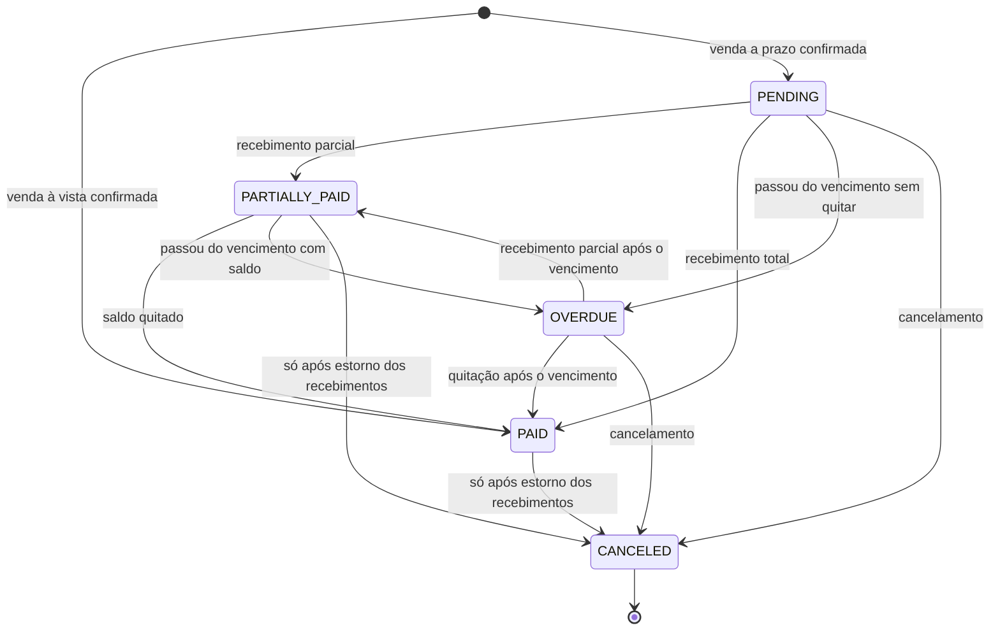
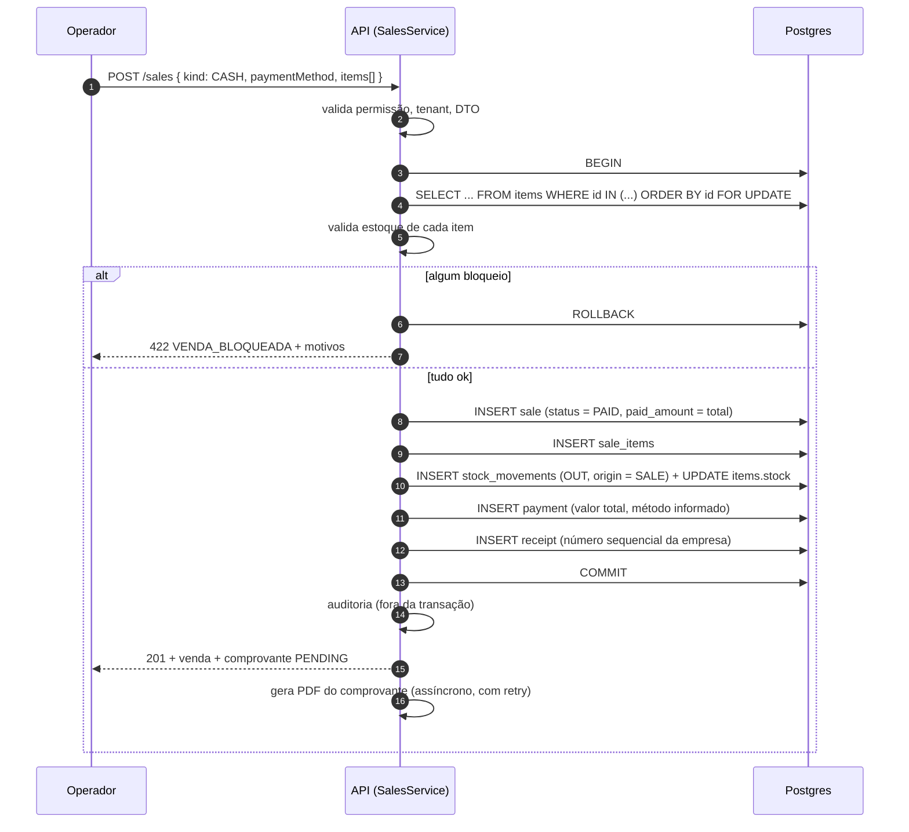
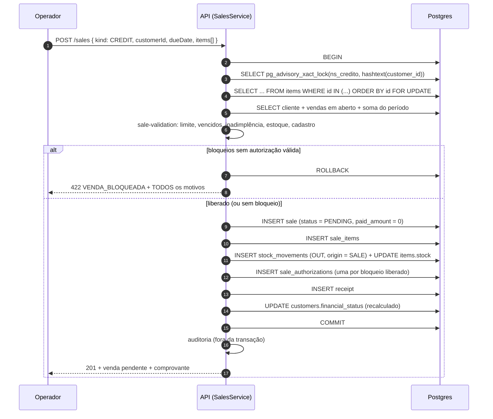

# Vendas

> Modelo de dados em [27](27-modelo-de-dados.md) · Endpoints em [28](28-api-contracts.md) ·
> Decisão de arquitetura em [ADR-0006](adr/0006-vendas-como-agregado-transacional.md)

## Estrutura

Uma venda é um **agregado**: cabeçalho + itens. Ela nunca existe pela metade.

```text
Sale
├── SaleItem  (1..N)   produto, quantidade, valor unitário, valor total
├── Payment   (0..N)   recebimentos
├── StockMovement (N)  baixa de estoque, um por item
├── SaleAuthorization (0..N)  liberações administrativas
└── Receipt   (0..1)   comprovante sem valor fiscal (RN-24)
```

### Cabeçalho (`sales`)

| Campo | Significado |
|---|---|
| `company_id` | Tenant. Nunca vem do corpo da requisição — vem do JWT |
| `customer_id` | Opcional em venda à vista, **obrigatório** em venda a prazo |
| `number` | Sequencial por empresa, emitido dentro da transação (mesmo padrão da RN-24) |
| `kind` | `CASH` (à vista) \| `CREDIT` (a prazo) |
| `payment_method` | `CASH` \| `CREDIT_CARD` \| `DEBIT_CARD` \| `PIX` \| `OTHER` — na venda à vista |
| `status` | `PENDING` \| `PARTIALLY_PAID` \| `PAID` \| `OVERDUE` \| `CANCELED` |
| `total` | Soma dos itens. Materializado (nunca recalculado no `SELECT`) |
| `paid_amount` | Soma dos recebimentos não estornados. Materializado |
| `discount` | Desconto no total da venda (opcional, ver [PD-06](31-decisoes-pendentes.md#pd-06)) |
| `due_date` | Obrigatório em `CREDIT`, `NULL` em `CASH` |
| `sold_at` | Data/hora do fato. **É ela que define a qual período a venda pertence** |
| `period_start` / `period_end` | Janela do período no momento da venda — congelada (ver [20](20-limite-mensal-e-periodos.md#congelamento)) |
| `created_by` | Usuário que registrou |
| `canceled_at` / `canceled_by` / `cancel_reason` | Preenchidos no cancelamento |

### Item (`sale_items`)

| Campo | Significado |
|---|---|
| `sale_id`, `item_id` | Ligações. `item_id` com `ON DELETE RESTRICT` |
| `quantity` | Inteiro positivo (a unidade do item é textual no MVP; fracionário é [PD-07](31-decisoes-pendentes.md#pd-07)) |
| `unit_price` | **Cópia** do preço do item no momento da venda |
| `total` | `unit_price × quantity`, arredondado a 2 casas |
| `item_name_snapshot`, `item_sku_snapshot` | Cópia do nome e do SKU no momento da venda |

**Por que copiar preço, nome e SKU.** O item é editável (`PATCH /items/:id`). Se a venda
apontasse só para o item, mudar o preço amanhã reescreveria o valor de todas as vendas de
ontem, e o fechamento do mês passado mudaria sozinho. Venda é fato consumado: ela guarda o
que foi combinado. É o mesmo princípio da RN-22 (movimentação imutável) aplicado ao
financeiro.

## Aritmética do dinheiro

- Tipo no banco: `DECIMAL(12,2)` para totais, `DECIMAL(10,2)` para preço unitário
  (compatível com `items.price`). **Nunca** `float`/`double`;
- No código, `Prisma.Decimal` de ponta a ponta. Nenhum `Number` intermediário: converter
  para `number` para "só somar" é o caminho conhecido para 0,1 + 0,2;
- Ordem de cálculo, fixada em `sale-totals.ts` (função pura):

```text
item.total  = round_half_up(unit_price * quantity, 2)
sale.total  = Σ item.total  - discount
balance     = sale.total - paid_amount
```

Arredondar **por item** e depois somar, e não somar cru e arredondar no fim: é assim que a
soma das linhas exibidas bate com o total exibido. Divergência de centavo entre a lista e o
rodapé é o tipo de bug que destrói confiança em sistema financeiro.

- `sale.total > 0` é `CHECK` no banco. Venda de valor zero não é venda;
- `paid_amount <= total` é `CHECK` no banco ([22](22-recebimentos.md)).

## Venda com e sem cliente

Venda **sem** cliente é permitida e é o caso comum do balcão. Ela:

- só pode ser `CASH` (à vista) — `CHECK` no banco:
  `kind = 'CASH' OR customer_id IS NOT NULL`;
- não participa de limite, inadimplência nem situação financeira;
- entra normalmente no faturamento e no fechamento;
- baixa estoque como qualquer outra.

Venda **a prazo sem cliente é impossível por construção**, não por validação de service.
Uma dívida sem devedor não é representável.

## Estados



Cinco estados, nenhum a mais. Foram considerados e **recusados**:

- **`DRAFT`/`OPEN`**: exigiria persistir venda não confirmada, e com ela a pergunta "esse
  rascunho reserva estoque?". Reservar cria estoque fantasma; não reservar torna a
  validação do rascunho mentirosa. A venda é criada e confirmada no mesmo `POST`
  (ADR-0006). Carrinho é estado de **UI**, não de banco;
- **`BLOCKED`**: bloqueio não é estado da venda, é resultado da validação **antes** de ela
  existir. Venda bloqueada não é gravada — a resposta é 422 com a lista de motivos
  ([24](24-liberacoes-administrativas.md));
- **`REFUNDED`**: estorno é fato do recebimento (`payments.reversed_at`), não da venda. Uma
  venda com todos os recebimentos estornados volta a `PENDING`/`OVERDUE`, que é a verdade —
  ela voltou a dever.

`OVERDUE` merece nota: é o **único estado dependente do relógio**, e por isso tem tratamento
específico em [21](21-inadimplencia.md#materialização) — derivado na leitura, materializado
por job.

## Venda à vista



A venda à vista nasce **`PAID`**, com um `Payment` de valor total já registrado. O
pagamento não é implícito: registrá-lo é o que faz "Total pago" do cliente e "Total
recebido" do fechamento serem uma única soma sobre `payments`, em vez de dois caminhos que
precisam concordar.

Ela **não** consome limite e **não** exige cliente.

## Venda a prazo



Diferenças em relação à venda à vista: exige `customerId` e `dueDate`, nasce `PENDING` com
`paid_amount = 0`, consome limite do período e passa pelo bloco de validação de crédito.

`dueDate` obrigatório: sem vencimento não há atraso, e sem atraso não há inadimplência —
toda a doc [21](21-inadimplencia.md) depende dele. O DTO aceita `dueDate` e, quando
omitido, o service aplica `FINANCE_DEFAULT_DUE_DAYS` (docs/16) sobre `sold_at`; `dueDate`
no passado é recusado com `VALIDACAO_FALHOU`.

## Validação

Todas as validações de uma venda são coletadas por `SaleValidationService` e devolvidas
**juntas**. Nunca a primeira que falhou.

| Bloqueio | Quando ocorre | Liberável? |
|---|---|---|
| `INSUFFICIENT_LIMIT` | `utilizado + total > credit_limit` | **Sim** (crédito) |
| `OVERDUE_PAYMENT` | Cliente tem venda vencida em aberto | **Sim** (crédito) |
| `CUSTOMER_DELINQUENT` | `financial_status = DELINQUENT` | **Sim** (crédito) |
| `INSUFFICIENT_STOCK` | `quantidade > items.stock` | Não — RN-21 mantida ([PD-01](31-decisoes-pendentes.md#pd-01)) |
| `CUSTOMER_INACTIVE` | Cliente `INACTIVE` | Não |
| `CUSTOMER_BLOCKED` | `blocked_for_credit = true` (bloqueio manual) | Não |
| `ITEM_INACTIVE` | Item `INACTIVE` | Não |
| `INVALID_DUE_DATE` | Vencimento no passado | Não |

Duas classes distintas: **bloqueios liberáveis** — só os de crédito, em que a venda é
possível e o negócio decidiu que ela é arriscada — e **bloqueios não liberáveis**, em que a
venda é impossível ou inconsistente. Nenhuma senha administrativa vende mercadoria que não
existe, nem vende para um cliente inativo: isso não é exceção de crédito, é falta de estoque
ou dado errado.

O nome dos motivos é enum de banco em inglês (`SaleBlockReason`), seguindo o padrão dos
enums existentes (`CompanyStatus`, `StockMovementType`). O código de erro HTTP devolvido é
o português `VENDA_BLOQUEADA`, seguindo o padrão de `BusinessErrorCode`. Os dois padrões já
convivem no MVP e continuam convivendo — ver [28](28-api-contracts.md#erros).

A validação **não confia** em `customers.financial_status` nem em nenhum contador
materializado: dentro da transação, com o cliente já travado, ela recomputa a partir das
vendas. O campo materializado serve para listar e filtrar; a decisão de crédito lê a
fonte.

## Consistência transacional

Tudo o que segue acontece em **uma** transação (`prisma.withTenantSession`, que é o helper
já usado pela movimentação de estoque):

```text
lock do cliente (só em venda a prazo)
lock dos itens
validação de limite / vencidos / inadimplência / estoque
INSERT sale
INSERT sale_items
INSERT stock_movements + UPDATE items.stock
INSERT sale_authorizations
INSERT payment          (só venda à vista)
INSERT receipt          (numeração sequencial)
UPDATE customers.financial_status
```

Falha em qualquer ponto → `ROLLBACK` → **nada** foi gravado. Os cenários que o requisito
exige impossibilitar ficam impossíveis por construção, não por cuidado do programador:

| Cenário proibido | Por que não acontece |
|---|---|
| Venda criada, estoque não baixado | Mesma transação |
| Estoque baixado, venda não criada | Mesma transação |
| Venda registrada, pagamento inicial perdido | Mesma transação |
| Venda gravada sem a auditoria da liberação | Mesma transação (`sale_authorizations`) |
| Duas vendas do mesmo item estourando o saldo | `FOR UPDATE` nos itens |
| Duas vendas do mesmo cliente estourando o limite | Advisory lock por cliente |
| Estoque negativo | `CHECK (stock >= 0)` em `items` (RN-21) |

**Fora da transação, deliberadamente:**

- `audit_logs` — a trilha registra o que aconteceu; erro ao auditar não pode desfazer uma
  venda válida. Mesmo raciocínio já aplicado em `InventoryService.createMovement`;
- geração do PDF do comprovante — derivada do banco, com retry, e não bloqueia nem atrasa a
  venda (docs/06).

Limites de tempo vêm de env (docs/16): `SALES_LOCK_TIMEOUT_MS` e
`SALES_TRANSACTION_TIMEOUT_MS`, com o teto da transação **maior** que o do lock — mesma
razão documentada em `inventory.service.ts`: se o Prisma abortar antes do Postgres devolver
`55P03`, o motivo real da falha some.

## Concorrência

Detalhe completo em [23](23-estoque-e-vendas.md#concorrência) e
[20](20-limite-mensal-e-periodos.md#concorrência). Resumo:

- **Estoque**: `SELECT ... FOR UPDATE` nas linhas dos itens, **ordenado por `id`**. A
  ordenação é o que impede deadlock quando duas vendas tocam os mesmos dois itens em ordem
  inversa;
- **Limite**: `pg_advisory_xact_lock(namespace, hashtext(customer_id))` no início da
  transação, antes de qualquer leitura de valor. Mesmo mecanismo que `ReceiptsService`
  usa para numerar comprovantes;
- **Ordem dos locks é fixa**: cliente → itens (por id). Sempre. Inverter em um único lugar
  reintroduz deadlock;
- Contenção vira **409 `CONFLITO_DE_CONCORRENCIA`**, não 500 — o código já existe em
  `BusinessErrorCode` e a tradução de `55P03`/`P2028` já está implementada em
  `inventory.service.ts` e deve ser **extraída para `shared/`** e reaproveitada, não
  copiada.

## Numeração da venda

`sales.number` é `BIGINT`, sequencial **por empresa**, único (`@@unique([companyId,
number])`), emitido dentro da transação da venda pelo mesmo padrão de advisory lock que
`ReceiptsService.allocate` usa hoje. Um segundo namespace de lock, para não serializar
venda e comprovante entre si sem necessidade.

Motivo de existir separado do comprovante: nem toda venda gera comprovante em todos os
cenários futuros, e o número da venda é o que o operador fala no telefone.

## Onde cada regra vive

| Regra | Onde | Por quê |
|---|---|---|
| Totais e arredondamento | `sales/sale-totals.ts` (pura) | Aritmética não precisa de banco para ser testada |
| Estado financeiro da venda | `sales/sale-status.policy.ts` (pura) | Tabela de decisão `total × pago × vencimento` |
| Janela do período | `finance/period.ts` (pura) | Calendário é onde os bugs de borda moram (dia 31, fevereiro, bissexto) |
| Situação do cliente | `customers/customer-status.policy.ts` (pura) | Idem |
| Coleta de bloqueios | `sales/sale-validation.service.ts` | Precisa de banco; devolve lista, não lança na primeira falha |
| Transação, locks, ordem | `sales/sales.service.ts` | Orquestração é responsabilidade do service |
| Unicidade, `CHECK`, FK | migrações Prisma | Invariante que não pode depender de código correto |
| Permissão e escopo | controller + guards existentes | Já resolvido pelo MVP; não reinventar |

Nenhuma regra em controller, DTO ou query. Nenhuma regra duplicada entre duas camadas: o
`CHECK` do banco e a validação do service cobrem **coisas diferentes** (o banco impede o
estado impossível; o service produz a mensagem que explica).

## Regras de negócio

| Regra | Descrição |
|---|---|
| RN-40 | Venda é criada e confirmada na mesma operação atômica; não existe venda em rascunho. |
| RN-41 | Venda a prazo exige cliente e vencimento; venda sem cliente é obrigatoriamente à vista. |
| RN-42 | Venda à vista nasce `PAID`, com recebimento de valor total registrado, e não consome limite. |
| RN-43 | Venda a prazo nasce `PENDING` e consome o limite do período em que ocorreu. |
| RN-44 | Item da venda guarda cópia de preço, nome e SKU do momento da venda. |
| RN-45 | Venda nunca é excluída; correção é cancelamento (doc [26](26-cancelamentos-e-estornos.md)). |
| RN-46 | `sales.number` é sequencial por empresa, sem buraco e sem repetição. |
| RN-47 | Toda validação de venda devolve **todos** os motivos de bloqueio, nunca só o primeiro. |
