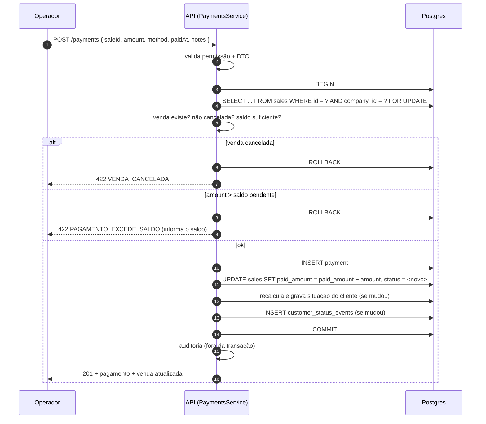

# Recebimentos (pagamentos)

> Modelo em [27](27-modelo-de-dados.md) · Endpoints em [28](28-api-contracts.md) ·
> Cancelamento e estorno em [26](26-cancelamentos-e-estornos.md)

## Estrutura

```text
Sale 1 ────── N Payment
```

Uma venda tem zero ou mais recebimentos. Venda à vista nasce com **um** recebimento de
valor total ([19](19-vendas.md#venda-à-vista)); venda a prazo nasce com zero e vai
recebendo.

Campos de `payments`:

| Campo | Obrigatório | Observação |
|---|---|---|
| `sale_id` | sim | |
| `company_id` | sim | Redundante com a venda, e **de propósito**: sem ele o model não entra no escopo automático de tenant nem nas policies de RLS |
| `customer_id` | não | Cópia da venda (venda sem cliente → `NULL`). Permite `GET /payments?customerId=` sem join |
| `amount` | sim | `DECIMAL(12,2)`, `CHECK (amount > 0)` |
| `method` | sim | `CASH` \| `CREDIT_CARD` \| `DEBIT_CARD` \| `PIX` \| `OTHER` |
| `paid_at` | sim | **Data real do recebimento**, informável (permite lançar o que foi pago ontem) |
| `notes` | não | Observação |
| `created_by` | sim | Usuário responsável |
| `created_at` | sim | Quando foi registrado no sistema — diferente de `paid_at` |
| `reversed_at`, `reversed_by`, `reversal_reason` | não | Estorno |

`paid_at` e `created_at` separados não é redundância: um é o fato no mundo, outro é o
registro no sistema. O fechamento por caixa usa `paid_at`; a auditoria de "quem lançou isso
e quando" usa `created_at`. Quando divergem muito, é justamente o que se quer investigar.

## Saldo e status

```text
saldo pendente = sale.total − sale.paid_amount

paid_amount  =  Σ payments.amount  WHERE reversed_at IS NULL
```

`sales.paid_amount` é **materializado** e atualizado na mesma transação do recebimento.
Sem ele, todo resumo de cliente, toda listagem de vendas e todo painel de fechamento
viraria um join com agregação sobre `payments`. Com ele, a consistência é garantida por
transação + `CHECK`:

```sql
CONSTRAINT sales_paid_amount_within_total CHECK (paid_amount >= 0 AND paid_amount <= total)
```

O `CHECK` é o que torna impossível — não improvável — receber mais que o devido, mesmo que
um bug futuro escape da validação do service.

Transição de status pela tabela de decisão de
[21](21-inadimplencia.md#estado-da-venda-tabela-de-decisão):

```text
pago = 0            → PENDING   (ou OVERDUE se vencida)
0 < pago < total    → PARTIALLY_PAID (ou OVERDUE se vencida)
pago = total        → PAID
```

## Fluxo do recebimento



O `SELECT ... FOR UPDATE` na venda é o que impede dois recebimentos simultâneos de lerem o
mesmo `paid_amount` e, cada um somando sobre o valor antigo, deixarem a venda paga pela
metade — ou pagas em dobro. Mesmo mecanismo do estoque, aplicado ao título.

Ordem de lock quando um recebimento também mexe no cliente: **venda → cliente**, sempre.
(A venda a prazo trava **cliente → itens**; recebimento nunca trava item, então as duas
ordens não se cruzam e não há ciclo.)

## Pagamento acima do saldo

Recusado. `422 PAGAMENTO_EXCEDE_SALDO`, com o saldo real na mensagem.

O requisito menciona "salvo se existir uma regra administrativa explicitamente definida".
Na fase 2 **essa regra não existe**, e a decisão é deliberada:

- aceitar pagamento a maior cria **crédito do cliente contra a empresa** — um passivo, com
  suas próprias perguntas (vale para qual venda? é devolvido? expira?);
- sem esse conceito modelado, o excedente vira `paid_amount > total`, que quebra o `CHECK`,
  quebra "Total recebido" do fechamento e quebra a definição de saldo.

O caminho correto quando o cliente paga R$ 100 numa conta de R$ 80 é registrar R$ 80 e
tratar os R$ 20 fora do sistema (ou como adiantamento, quando o conceito existir). Ver
[PD-11](31-decisoes-pendentes.md#pd-11).

## Pagamento após o fechamento do período

Situação: venda de 10/09 (período de setembro), paga em 03/10 (período de outubro).

Regra: **a venda não muda de período. O pagamento pertence ao período em que ocorreu.**

```text
Venda   → período pelo sold_at  (setembro)
Pagamento → período pelo paid_at (outubro)
```

Nada de "reabrir" setembro, nada de mover a venda. O que muda é como o painel apresenta —
e ele apresenta os **dois regimes lado a lado**, com rótulo:

| Bloco | Base | Responde |
|---|---|---|
| **Competência** (o que foi vendido) | `sales.sold_at ∈ período` | "quanto vendi em setembro" |
| **Caixa** (o que entrou) | `payments.paid_at ∈ período` | "quanto recebi em outubro" |

O detalhe completo, incluindo o bloco "recebido no período referente a vendas de períodos
anteriores", está em [25](25-fechamento-mensal.md#competência-e-caixa).

Consequência prática que precisa estar escrita: **o total recebido de um período fechado
pode aumentar depois**, porque um título antigo pode ser pago hoje. Isso não é
inconsistência — é a natureza de venda a prazo. O que **não** muda depois de fechado é o
total vendido do período.

## Estorno de recebimento

Recebimento **não é apagado nem editado**. Estornar cria a marcação `reversed_at` no
próprio registro e devolve o valor ao saldo:

```text
UPDATE payments SET reversed_at = now(), reversed_by = ?, reversal_reason = ?
UPDATE sales    SET paid_amount = paid_amount − amount, status = <recalculado>
recalcula situação do cliente
```

Por que marcação e não linha negativa: o recebimento é um registro pontual, não um saldo
acumulado como o estoque. Uma "linha de estorno" separada faria toda consulta de
recebimento precisar parear entradas com estornos para saber o que vale. A marcação mantém
`Σ amount WHERE reversed_at IS NULL` como a única soma necessária. (No estoque a escolha é
a oposta — movimentação inversa — porque lá o histórico *é* a série temporal que reconstrói
o saldo, RN-22.)

Estorno exige permissão própria (`payments:delete`), motivo obrigatório, e é sempre auditado.
A rota é `POST /payments/:id/reversal` ([PD-15](31-decisoes-pendentes.md#pd-15)). Um recebimento já estornado não é estornável de novo (`CHECK` de negócio +
verificação sob lock).

Estornar um recebimento pode **reinadimplir** o cliente — se o título volta a ter saldo e já
está vencido. Isso é correto e deve gerar seu `customer_status_events`.

## Regras de negócio

| Regra | Descrição |
|---|---|
| RN-70 | Uma venda pode ter múltiplos recebimentos; o saldo é `total − Σ recebimentos não estornados`. |
| RN-71 | Recebimento acima do saldo pendente é recusado. |
| RN-72 | Recebimento em venda cancelada é recusado. |
| RN-73 | `sales.paid_amount` é atualizado na mesma transação do recebimento e nunca excede `total` (garantido por `CHECK`). |
| RN-74 | Recebimento nunca é editado nem excluído: correção é estorno com motivo, auditado. |
| RN-75 | O pagamento pertence ao período do `paid_at`; a venda permanece no período do `sold_at`. |
| RN-76 | Estorno recalcula status da venda e situação do cliente, podendo reinadimplir. |
