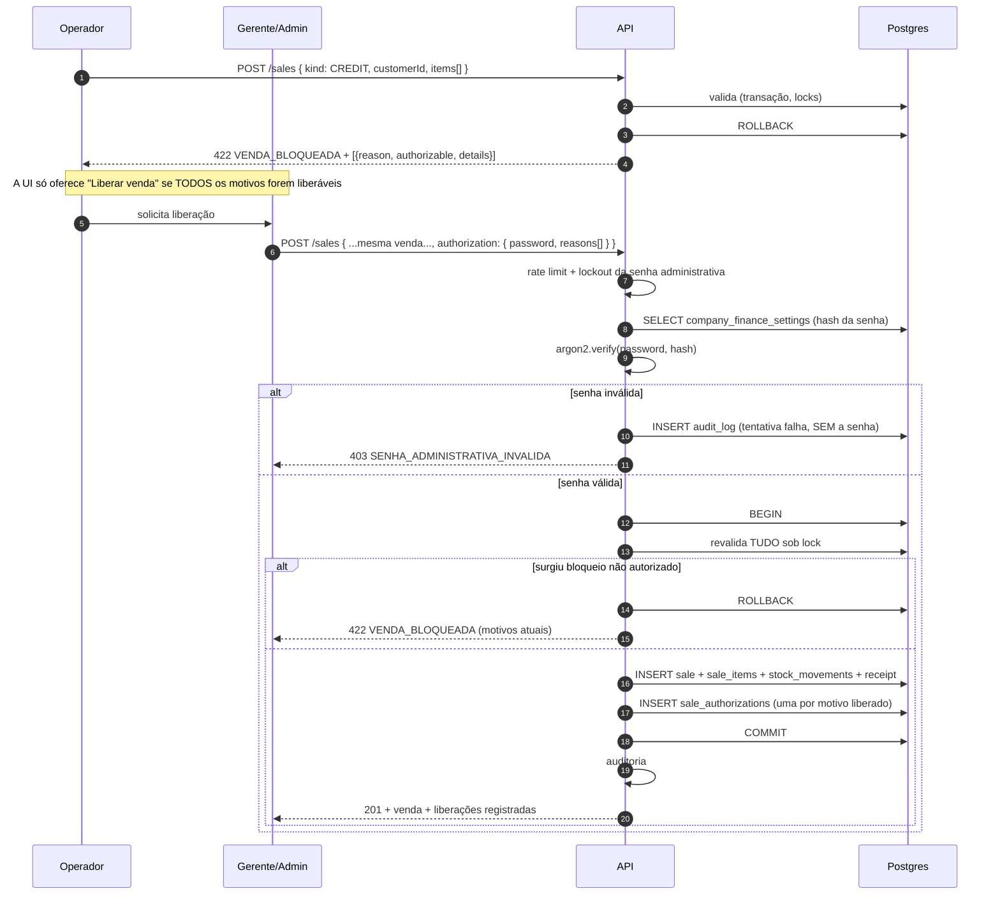

# Liberações administrativas

> Bloqueios em [19](19-vendas.md#validação) · Segurança da senha em [29](29-seguranca-e-permissoes.md)

> **Escopo definido em [PD-01](31-decisoes-pendentes.md#pd-01):** existe **um único tipo** de
> liberação — **crédito**. A RN-21 foi mantida absoluta, então estoque insuficiente é
> bloqueio **não liberável** e não há liberação de estoque
> ([23](23-estoque-e-vendas.md#estoque-negativo)).

## Natureza da liberação

> A liberação é uma **exceção para UMA venda**.

Ela **não**:

| Não faz | Por quê |
|---|---|
| aumenta o limite | Limite é configuração (`PATCH /customers/:id/credit-limit`), não consequência de uma venda |
| remove inadimplência | Inadimplência é derivada de títulos vencidos; some quando eles são pagos |
| remove débito vencido | O título continua vencido e devido |
| aumenta o estoque | Estoque só muda por movimentação — e não há liberação de estoque |
| altera vencimento | Vencimento é da venda que se está criando |
| altera o fechamento | Fechamento é configuração da empresa |
| desbloqueia vendas futuras | Cada venda bloqueada exige nova liberação |

A liberação é **consumida no ato**: ela existe apenas dentro da transação da venda que
autorizou, e o registro que sobra é a trilha do que foi autorizado. Não existe "cliente
liberado", não existe liberação pendente, não existe liberação reaproveitável.

Consequência prática, que é o efeito desejado: cada exceção custa uma decisão consciente de
alguém com senha. É isso que impede que "liberar" vire hábito.

## Bloqueios: o que é e o que não é liberável

`SaleBlockReason` (enum de banco, inglês — padrão dos enums do projeto):

| Motivo | Liberável | Categoria |
|---|---|---|
| `INSUFFICIENT_LIMIT` | **sim** | Crédito |
| `OVERDUE_PAYMENT` | **sim** | Crédito |
| `CUSTOMER_DELINQUENT` | **sim** | Crédito |
| `INSUFFICIENT_STOCK` | não | Físico — a mercadoria não existe |
| `CUSTOMER_INACTIVE` | não | Cadastro inconsistente |
| `CUSTOMER_BLOCKED` | não | Bloqueio manual, só quem bloqueou desfaz |
| `ITEM_INACTIVE` | não | Cadastro inconsistente |
| `INVALID_DUE_DATE` | não | Dado inválido |

A linha divisória é clara e vale a pena nomeá-la: **liberável é o que o negócio decidiu que é
arriscado; não liberável é o que é impossível ou inconsistente**. Nenhuma senha vende
mercadoria que não existe, para um cliente inativo, com vencimento no passado.

`SaleAuthorizationType` fica com um único valor, `CREDIT`. O enum existe mesmo assim — em vez
de um booleano — porque é o ponto de extensão registrado: se um dia surgir outra categoria de
exceção, ela entra aqui sem migração de estrutura.

## Múltiplos bloqueios simultâneos

Uma venda pode ter vários bloqueios ao mesmo tempo — limite estourado **e** cliente
inadimplente, por exemplo. A representação:

- a validação devolve **todos** os motivos, cada um com `authorizable` já resolvido pelo
  servidor;
- a liberação é **por motivo**: o operador declara quais está autorizando;
- cada motivo autorizado gera **uma linha** em `sale_authorizations`;
- se sobrar **qualquer** motivo não autorizado — inclusive um não liberável —, a venda é
  recusada por inteiro. Não existe venda meio liberada.

```text
Venda bloqueada por: INSUFFICIENT_LIMIT + CUSTOMER_DELINQUENT

Autoriza só INSUFFICIENT_LIMIT   →  422, ainda bloqueada por inadimplência
Autoriza os dois                 →  201, duas linhas em sale_authorizations

Venda bloqueada por: INSUFFICIENT_LIMIT + INSUFFICIENT_STOCK
Autoriza o que dá                →  422 sempre: estoque não é liberável
```

Uma senha, uma requisição, N linhas de auditoria. Pedir senha duas vezes na mesma venda seria
teatro de segurança: quem tem a senha já demonstrou que a tem.

## Fluxo



Dois pontos não óbvios:

**A senha é verificada FORA da transação, antes de abri-la.** Argon2 é deliberadamente lento
(centenas de ms). Verificá-la com locks de item e de cliente já tomados seguraria a fila de
vendas daquele item por todo esse tempo, e um ataque de senha viraria negação de serviço no
estoque.

**A validação é refeita DENTRO da transação.** Entre o 422 que mostrou os motivos e o `POST`
com a senha, o mundo mudou: outra venda pode ter consumido o estoque, o cliente pode ter
pago. Se surgir um motivo que **não** estava na lista autorizada — e estoque acabando é
justamente o caso mais provável —, a venda é recusada de novo. Autorizar
`INSUFFICIENT_LIMIT` não é cheque em branco para o que apareceu depois.

Motivos que estavam na lista autorizada e **sumiram** (o cliente pagou no intervalo) não
impedem nada: simplesmente não geram linha de autorização, porque não houve exceção.

## A senha administrativa

Decidido em [PD-13](31-decisoes-pendentes.md#pd-13): **uma senha por empresa**.

- guardada em `company_finance_settings.admin_password_hash`;
- **argon2id**, o mesmo algoritmo e a mesma configuração das senhas de usuário (docs/09) —
  não é "só um PIN";
- definida e alterada por `PUT /companies/me/finance-settings/admin-password`, exigindo a
  senha **do próprio usuário** logado (não a antiga senha administrativa: se ela foi
  esquecida ou vazou, exigir a antiga trancaria a empresa para fora);
- **nunca** trafega em query string, **nunca** entra em log, **nunca** entra em
  `audit_logs.diff`, **nunca** volta em resposta. O DTO que a recebe fica marcado para
  redação no logger, junto com `password` e tokens;
- rate limit dedicado **por usuário** (`@Throttle` na rota, valores de env) **e** lockout
  progressivo **por empresa**, reaproveitando a política já implementada em
  `src/modules/auth/lockout`;
- tentativa falha **é auditada** (`sale-authorization.password-failed`) com autor, IP e
  timestamp — e sem a senha, obviamente.

Duas consequências assumidas com a escolha "por empresa", registradas para não serem
descobertas depois:

1. **A senha não identifica quem liberou.** Quem aparece em `authorized_by` é o usuário do
   JWT, não a senha. Isso é aceitável porque a senha é o *segundo* fator: o primeiro é estar
   logado com permissão de liberar;
2. **O lockout afeta o balcão inteiro.** Cinco erros travam as liberações da empresa. Por
   isso o lockout **não** bloqueia vendas normais, só liberações, e o rate limit é por
   usuário antes de ser por empresa — um operador errando não trava imediatamente o outro.

A senha **não substitui a permissão**: quem não tem `credit-authorizations:create` recebe 403
antes de a senha ser sequer verificada.

## Trilha de auditoria da liberação

Tabela `sale_authorizations`, append-only, uma linha por motivo liberado:

| Campo | Origem | Obrigatório |
|---|---|---|
| `id` | uuid | sim |
| `company_id` | JWT | sim — tenant scoping e RLS |
| `sale_id` | venda criada na mesma transação | sim |
| `customer_id` | cópia da venda | sim (só venda a prazo é liberável, e ela sempre tem cliente) |
| `sale_total` | **cópia** do total no momento | sim |
| `block_reason` | `SaleBlockReason` | sim |
| `authorization_type` | `SaleAuthorizationType` (hoje sempre `CREDIT`) | sim |
| `requested_by` | usuário que montou a venda | sim |
| `authorized_by` | usuário que digitou a senha | sim |
| `authorized_at` | timestamptz | sim |
| `context` | jsonb — os números do momento | sim |
| `notes` | justificativa livre | não |

O `context` é o que transforma a trilha em algo utilizável meses depois:

```jsonc
// INSUFFICIENT_LIMIT
{ "creditLimit": "1000.00", "periodUsed": "1000.00", "available": "0.00",
  "saleTotal": "300.00", "periodStart": "2026-08-16", "periodEnd": "2026-09-16" }

// OVERDUE_PAYMENT
{ "overdueSalesCount": 2, "overdueTotal": "450.00", "oldestDueDate": "2026-07-10",
  "daysLate": 54 }

// CUSTOMER_DELINQUENT
{ "delinquentSince": "2026-08-09", "overdueTotal": "450.00", "daysLate": 54,
  "delinquencyDays": 30 }
```

`sale_total` e `context` são **cópias**, não joins. O ponto da auditoria é responder "o que
essa pessoa sabia quando autorizou" — e isso não pode ser recalculado depois, porque os
números mudaram.

O `requested_by` × `authorized_by` separados respondem a pergunta de controle interno mais
comum: quem pediu e quem aprovou eram a mesma pessoa?

Além da tabela dedicada, a liberação também gera `audit_logs`
(`action = 'sale.authorized'`), que é a trilha genérica exigida pelo RNF-06. As duas
convivem pelo mesmo motivo que `receipts` convive com `audit_logs`: a tabela dedicada é
consultável pelo negócio (aparece no fechamento, filtrável por cliente); a genérica é a
trilha forense.

**Nunca, em nenhuma das duas, a senha.**

## Configuração

| Variável | Papel | Padrão sugerido |
|---|---|---|
| `SALE_AUTH_RATE_LIMIT_MAX` | Tentativas de senha por janela, por usuário | `5` |
| `SALE_AUTH_RATE_LIMIT_TTL_MS` | Janela do rate limit | `60000` |
| `SALE_AUTH_MAX_ATTEMPTS` | Tentativas antes do lockout da empresa | `5` |
| `SALE_AUTH_LOCKOUT_DURATION_MS` | Duração do lockout (progressivo) | `900000` |

## Regras de negócio

| Regra | Descrição |
|---|---|
| RN-90 | Liberação é exceção para uma única venda e não altera limite, inadimplência, débito, estoque, vencimento nem fechamento. |
| RN-91 | Cada venda bloqueada exige nova liberação; liberação não é reaproveitável. |
| RN-92 | Só bloqueios de **crédito** são liberáveis. Estoque, cadastro inconsistente e dado inválido nunca são. |
| RN-93 | Bloqueio não autorizado remanescente recusa a venda inteira. |
| RN-94 | A validação é refeita sob lock após a senha; motivo novo não coberto pela autorização recusa a venda. |
| RN-95 | A senha administrativa é da empresa, com hash argon2id, nunca em log, histórico ou resposta. |
| RN-96 | Tentativa de senha inválida é auditada, sofre rate limit por usuário e alimenta lockout progressivo por empresa. |
| RN-97 | Cada motivo liberado gera uma linha em `sale_authorizations` com cópia dos valores do momento. |
