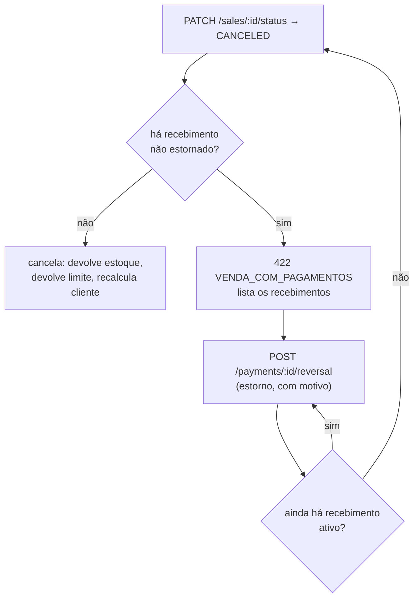

# Cancelamentos e estornos

## Princípio

Venda **nunca é apagada**. Cancelar é mudar o status para `CANCELED` e gerar os efeitos
inversos — mantendo tudo o que aconteceu visível.

É a mesma filosofia da RN-22 (movimentação imutável) e da RN-23 (item com histórico é
inativado, não excluído), agora aplicada ao financeiro.

## Quem pode cancelar

Permissão `sales:delete` ([29](29-seguranca-e-permissoes.md)). O mapeamento
"delete = cancelar" segue o precedente do MVP: `DELETE /items/:id` já significa "inativar
quando há histórico", e a resposta informa o desfecho. Aqui não há ambiguidade — o desfecho
é sempre cancelamento.

A rota segue o padrão de mudança de estado já usado em itens:

```text
PATCH /sales/:id/status   { "status": "CANCELED", "reason": "cliente desistiu" }
```

e não `POST /sales/:id/cancel`, para não inventar um padrão de URL que o projeto não usa
(`PATCH /items/:id/status` é o precedente).

`reason` é **obrigatório**, mínimo de caracteres validado no DTO. Cancelamento sem motivo é
exatamente o registro que não serve para nada seis meses depois.

## O que o cancelamento registra

| Campo | Conteúdo |
|---|---|
| `sales.status` | `CANCELED` |
| `sales.canceled_at` | timestamptz |
| `sales.canceled_by` | usuário |
| `sales.cancel_reason` | texto obrigatório |

Mais uma linha em `audit_logs` (`action = 'sale.canceled'`) com o estado anterior.

## Efeitos do cancelamento

Tudo em **uma transação**:

```text
BEGIN
  SELECT ... FROM sales WHERE id = ? AND company_id = ? FOR UPDATE
  verifica: status ≠ CANCELED  (senão TRANSICAO_INVALIDA)
  verifica: não há recebimento ativo  (senão VENDA_COM_PAGAMENTOS)

  SELECT ... FROM items WHERE id = ANY(...) ORDER BY id FOR UPDATE
  para cada sale_item:
      INSERT stock_movements (type = IN, origin = SALE_CANCELLATION,
                              sale_id, sale_item_id, quantity,
                              reason = 'Cancelamento da venda #<number>')
      UPDATE items SET stock = stock + quantity

  UPDATE sales SET status = CANCELED, canceled_at, canceled_by, cancel_reason
  recalcula e grava situação financeira do cliente (se mudou)
  INSERT customer_status_events (se mudou)
COMMIT
```

### Estoque: movimentação inversa, nunca alteração

> Não altere ou exclua a movimentação original. Gere uma movimentação inversa.

A movimentação de saída original permanece intacta (RN-22). O cancelamento gera uma
movimentação de **entrada** (`type = IN`, `origin = SALE_CANCELLATION`) apontando para o
mesmo `sale_item_id`. O índice único `(sale_item_id, origin)` garante que uma venda
cancelada duas vezes não devolve estoque duas vezes — e o lock sobre a venda garante que a
segunda tentativa nem chega lá.

O histórico do item passa a contar a história completa: saiu por causa da venda, voltou por
causa do cancelamento.

**Não existe cancelamento com estoque negativo**: a RN-21 foi mantida absoluta
([PD-01](31-decisoes-pendentes.md#pd-01)), então nenhuma venda deixa saldo negativo para
trás. A devolução apenas soma ao saldo atual, sem tratamento especial.

### Limite

Cancelar **devolve** o limite utilizado do período, porque a fórmula de utilizado exclui
vendas canceladas ([20](20-limite-mensal-e-periodos.md#fórmula)).

Isso **não** contradiz "pagamento não devolve limite". São coisas diferentes:

```text
Pagamento  →  a compra aconteceu e foi quitada. O volume do período permanece.
Cancelamento → a compra NÃO aconteceu. Não há volume a computar.
```

É uma decisão de negócio e está registrada como tal em
[PD-02](31-decisoes-pendentes.md#pd-02), inclusive com a alternativa (não devolver, para
impedir o padrão "compra, cancela, recompra" como forma de contornar o limite) e o
mitigante recomendado (permissão restrita + auditoria + linha no fechamento).

### Situação financeira

Cancelar uma venda vencida pode **regularizar** o cliente — se era a única em atraso. O
recálculo acontece na mesma transação e gera `customer_status_events` com
`reason = 'SALE_CANCELED'`.

Isso é correto, e é também o motivo de o cancelamento merecer permissão restrita: é uma
forma de limpar inadimplência que não passa por pagamento.

### Liberações

`sale_authorizations` da venda cancelada **permanecem**. Elas registram que alguém
autorizou uma exceção — fato que continua verdadeiro depois do cancelamento. O painel de
fechamento conta liberações de vendas canceladas em linha separada, para que "cancelar
depois" não seja um jeito de sumir com a exceção da estatística.

### Comprovante

O comprovante da venda cancelada **não** é apagado nem tem o número reaproveitado (RN-24: a
numeração não tem buraco nem repetição). Ele passa a ser exibido com a marca de cancelado,
e a regeneração do PDF inclui essa marca.

## Cancelamento com pagamentos

> Caso a venda tenha pagamentos registrados, o cancelamento simples deverá ser bloqueado.

Regra: venda com **qualquer** recebimento ativo (não estornado) não é cancelável
diretamente. Resposta `422 VENDA_COM_PAGAMENTOS`, com a lista dos recebimentos e a
instrução do caminho correto.



Dois passos explícitos, cada um com sua permissão (`payments:delete` e `sales:delete`) e
seu motivo registrado. Não existe cancelamento em cascata que estorna sozinho: devolver
dinheiro é decisão de outra natureza, e escondê-la dentro de um "cancelar" é como o
dinheiro some sem que ninguém tenha decidido.

### Estorno como fluxo financeiro (conceitual)

O estorno implementado na fase 2 é **contábil**: marca o recebimento como estornado e
devolve o saldo à venda. Ele **não** movimenta dinheiro — não há gateway (docs/02), e a
devolução física (PIX de volta, dinheiro do caixa) acontece fora do sistema.

O que fica registrado, e que é o suficiente para a devolução ser rastreável:

```text
payments.reversed_at        quando
payments.reversed_by        quem
payments.reversal_reason    por quê
audit_logs                  a trilha genérica (RNF-06)
```

O que **fica para uma fase futura**, documentado aqui para não ser reinventado:

| Conceito futuro | O que resolveria |
|---|---|
| `refunds` (devolução financeira) | Registrar a saída de caixa: valor, método, comprovante da devolução, quem entregou. Hoje o estorno some do "Total recebido" sem aparecer como saída |
| Devolução **parcial de mercadoria** | Cancelar item da venda em vez da venda inteira; exige `sale_items.canceled_quantity` e movimentação parcial |
| Crédito do cliente (adiantamento) | Guardar valor pago a maior como crédito aplicável a vendas futuras — ver [PD-11](31-decisoes-pendentes.md#pd-11) |
| Nota de crédito / troca | Substituir mercadoria sem movimentar dinheiro |

Nenhum deles é pré-requisito da fase 2, e todos ficam mais fáceis por o estorno já ser
append-only.

## Regras de negócio

| Regra | Descrição |
|---|---|
| RN-110 | Venda não é excluída; cancelamento muda o status e registra autor, data, hora e motivo obrigatório. |
| RN-111 | O cancelamento gera movimentação de entrada por item; a movimentação original permanece intacta. |
| RN-112 | Uma venda cancelada não gera devolução de estoque duas vezes (índice único + lock). |
| RN-113 | Cancelamento devolve o limite utilizado do período; pagamento não. |
| RN-114 | Venda com recebimento ativo não é cancelável: é preciso estornar antes, com motivo. |
| RN-115 | Liberações administrativas e comprovante da venda cancelada permanecem registrados. |
| RN-116 | Cancelamento recalcula a situação financeira do cliente e pode regularizá-lo. |
