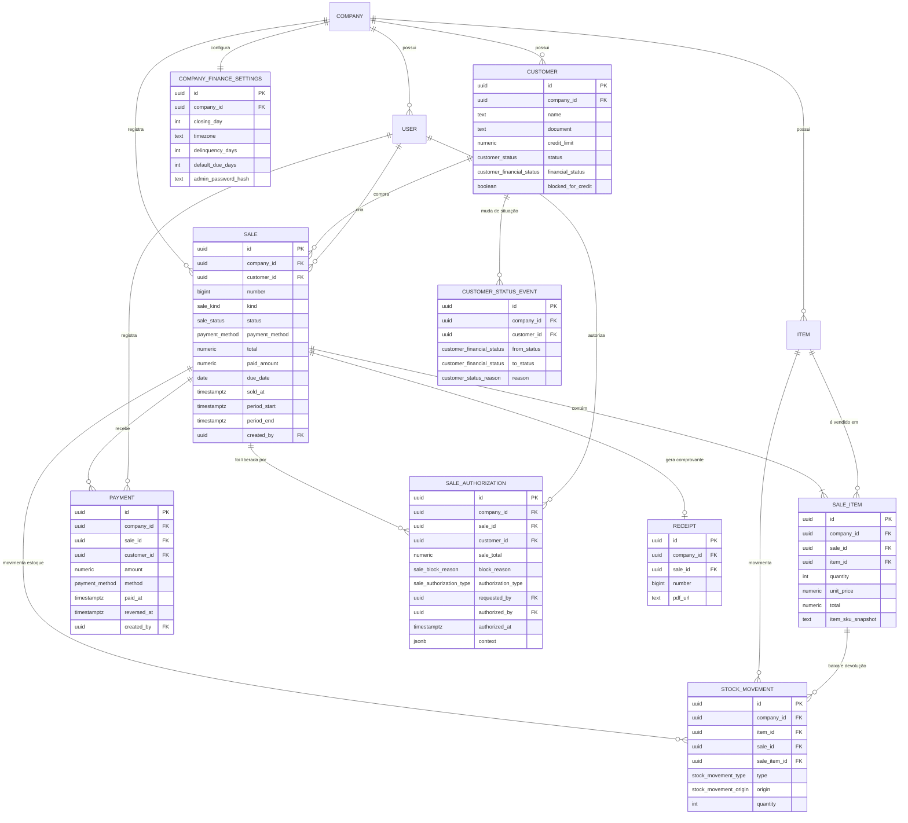

# Modelo de dados — fase 2

> ERD do MVP em [06](06-arquitetura.md#modelo-inicial-do-banco-erd) · Multi-tenancy em [ADR-0003](adr/0003-multi-tenancy-postgres.md)

## O que já existe e é reaproveitado

Antes de propor tabela nova, o levantamento do que **não** precisa ser criado:

| Tabela existente | Papel na fase 2 |
|---|---|
| `companies` | Dona de tudo. **Não recebe coluna nova** |
| `users` | Autor de venda, recebimento, cancelamento, liberação |
| `roles`, `permissions`, `role_permissions`, `user_roles` | Permissionamento — ganham linhas, não estrutura |
| `items` | Produto vendido. **Não recebe coluna nova** |
| `stock_movements` | Baixa e devolução — ganha `origin`, `sale_id`, `sale_item_id` |
| `receipts` | Comprovante — ganha `sale_id` |
| `audit_logs` | Trilha genérica (RNF-06) — ganha linhas, não estrutura |
| `subscriptions`, `plans` | Estrutura inalterada; `plans.limits` (JSONB) ganha a chave `maxCustomers` ([PD-08](31-decisoes-pendentes.md#pd-08)) |

**Por que `companies` não recebe colunas.** Dia de fechamento, fuso, permissão de estoque
negativo e hash da senha administrativa são **configuração financeira**, com ciclo de vida e
sensibilidade próprios. Uma tabela 1:1 (`company_finance_settings`) mantém a tabela de
tenant enxuta, permite política de acesso específica para o hash da senha, e faz "a empresa
já configurou o financeiro?" ser uma pergunta com resposta (`row existe`) em vez de
`closing_day IS NULL`.

## Convenções aplicadas

Herdadas de [08](08-padroes-de-desenvolvimento.md) e do schema atual, sem exceção:

- tabelas `snake_case` no plural, colunas `snake_case`, models Prisma `PascalCase` com
  `@@map`;
- PK `uuid` com `@default(uuid()) @db.Uuid`;
- `created_at`/`updated_at` como `@db.Timestamptz(3)`;
- **sem soft delete**: o projeto não usa `deleted_at` em lugar nenhum. O equivalente é
  status (`INACTIVE`, `CANCELED`) — e a fase 2 mantém isso;
- dinheiro em `Decimal`, nunca float;
- enums de banco em inglês maiúsculo com `@@map` snake_case;
- `company_id` em **toda** tabela de negócio, mesmo quando derivável por join.

Essa última merece justificativa: `payments.company_id` é redundante com
`payments.sale.company_id`. É intencional. Sem a coluna, o model não pode entrar em
`TENANT_SCOPED_MODELS` (a Client Extension filtra por campo, não por join), não pode ter
policy de RLS simples, e todo índice de relatório precisaria de join. A redundância é
protegida por FK composta, descrita adiante.

## Enums novos

```prisma
enum CustomerStatus          { ACTIVE  INACTIVE                                    @@map("customer_status") }
enum CustomerFinancialStatus { REGULAR OVERDUE DELINQUENT                          @@map("customer_financial_status") }
enum SaleKind                { CASH    CREDIT                                      @@map("sale_kind") }
enum SaleStatus              { PENDING PARTIALLY_PAID PAID OVERDUE CANCELED        @@map("sale_status") }
enum PaymentMethod           { CASH CREDIT_CARD DEBIT_CARD PIX OTHER               @@map("payment_method") }
enum SaleBlockReason         { INSUFFICIENT_LIMIT OVERDUE_PAYMENT CUSTOMER_DELINQUENT
                               INSUFFICIENT_STOCK CUSTOMER_INACTIVE CUSTOMER_BLOCKED
                               ITEM_INACTIVE INVALID_DUE_DATE                      @@map("sale_block_reason") }
// SaleAuthorizationType tem um único valor hoje (PD-01: não há liberação de estoque).
// Continua sendo enum, e não booleano, para ser o ponto de extensão de categorias futuras.
enum SaleAuthorizationType   { CREDIT                                              @@map("sale_authorization_type") }
enum StockMovementOrigin     { MANUAL  SALE SALE_CANCELLATION                      @@map("stock_movement_origin") }
enum CustomerStatusReason    { SALE PAYMENT PAYMENT_REVERSAL SALE_CANCELED
                               OVERDUE_JOB MANUAL                                  @@map("customer_status_reason") }
```

`PaymentMethod.CASH` e `SaleKind.CASH` coexistem sem ambiguidade: são enums diferentes, um
é "condição" e o outro é "meio". Em português a UI diz "à vista" e "dinheiro".

## Alterações em tabelas existentes

### `stock_movements`

```prisma
model StockMovement {
  // ... campos atuais preservados ...
  origin      StockMovementOrigin @default(MANUAL)
  saleId      String?             @map("sale_id")      @db.Uuid
  saleItemId  String?             @map("sale_item_id") @db.Uuid

  sale     Sale?     @relation(fields: [saleId],     references: [id], onDelete: Restrict)
  saleItem SaleItem? @relation(fields: [saleItemId], references: [id], onDelete: Restrict)

  @@index([saleId])
  // idempotência: um item de venda tem no máximo uma baixa e uma devolução
  @@unique([saleItemId, origin], map: "stock_movements_sale_item_origin_uniq")
}
```

Migração aditiva: colunas nullable + default. Nenhuma linha existente é tocada além de
receber `origin = 'MANUAL'`.

`CHECK` de coerência (SQL cru na migração, o Prisma não modela `CHECK`):

```sql
ALTER TABLE stock_movements ADD CONSTRAINT stock_movements_origin_refs CHECK (
  (origin = 'MANUAL'            AND sale_id IS NULL     AND sale_item_id IS NULL) OR
  (origin IN ('SALE','SALE_CANCELLATION') AND sale_id IS NOT NULL AND sale_item_id IS NOT NULL)
);
```

> **Sobre o `@@unique` parcial:** Prisma não gera índice único **parcial**. A migração deve
> substituir o índice gerado por `CREATE UNIQUE INDEX ... WHERE sale_item_id IS NOT NULL`
> escrito à mão. Funcionalmente o Postgres já ignora `NULL` em índice único, mas o `WHERE`
> deixa a intenção explícita e evita depender desse comportamento.

### `receipts`

```prisma
model Receipt {
  // ... campos atuais preservados ...
  saleId String? @unique @map("sale_id") @db.Uuid
  sale   Sale?   @relation(fields: [saleId], references: [id], onDelete: Restrict)
}
```

Com `CHECK` garantindo origem única — um comprovante é de uma saída manual **ou** de uma
venda, nunca dos dois:

```sql
-- stock_movement é o lado inverso (stock_movements.receipt_id), então a checagem
-- da exclusividade fica na aplicação + neste índice de apoio.
CREATE UNIQUE INDEX receipts_sale_uniq ON receipts (sale_id) WHERE sale_id IS NOT NULL;
```

Motivo detalhado em [23](23-estoque-e-vendas.md#impacto-no-comprovante).

## Tabelas novas

### `company_finance_settings`

Configuração financeira da empresa. 1:1 com `companies`.

| Campo | Tipo | Notas |
|---|---|---|
| `id` | uuid PK | |
| `company_id` | uuid, **unique**, FK → `companies` `ON DELETE CASCADE` | 1:1 |
| `closing_day` | int | `CHECK (closing_day BETWEEN 1 AND 31)`; default de env |
| `timezone` | text | IANA (`America/Sao_Paulo`); default de env |
| `delinquency_days` | int | `CHECK (> 0)`; default de env. Permite override por empresa |
| `default_due_days` | int | `CHECK (> 0)` |
| `admin_password_hash` | text? | argon2id. `NULL` = liberação administrativa indisponível |
| `admin_password_updated_at` | timestamptz? | |
| `admin_password_failed_attempts` | int, default 0 | Lockout progressivo |
| `admin_password_locked_until` | timestamptz? | |
| `created_at`, `updated_at` | timestamptz(3) | |

Não há `allow_negative_stock`: a RN-21 é absoluta ([PD-01](31-decisoes-pendentes.md#pd-01)),
então não existe configuração para desligá-la.

`admin_password_hash` nullable é deliberado: empresa que nunca configurou senha
administrativa simplesmente **não consegue liberar venda** — que é o padrão seguro.
Bloqueio é o default; exceção exige configuração.

Índice: o `@@unique([companyId])` já basta.

### `customers`

| Campo | Tipo | Notas |
|---|---|---|
| `id` | uuid PK | |
| `company_id` | uuid FK → `companies` `CASCADE` | Tenant |
| `name` | text | |
| `document` | text? | CPF/CNPJ |
| `email`, `phone` | text? | |
| `address` | jsonb? | |
| `notes` | text? | |
| `credit_limit` | `Decimal(12,2)` default 0 | `CHECK (credit_limit >= 0)` |
| `status` | `CustomerStatus` default `ACTIVE` | |
| `financial_status` | `CustomerFinancialStatus` default `REGULAR` | Cache materializado |
| `blocked_for_credit` | boolean default false | Bloqueio manual |
| `anonymized_at` | timestamptz(3)? | LGPD ([PD-17](31-decisoes-pendentes.md#pd-17)): marca cliente anonimizado |
| `created_at`, `updated_at` | timestamptz(3) | |

```prisma
@@unique([companyId, document], map: "customers_company_document_uniq")  // parcial: WHERE document IS NOT NULL
@@index([companyId])
@@index([companyId, status])
@@index([companyId, financialStatus])
@@index([companyId, name])          // busca por nome (RF-31 análogo)
```

`anonymized_at` preenchido significa: nome substituído por rótulo genérico e
`document`/`email`/`phone`/`address` zerados a pedido do titular, com as vendas preservadas.
Cliente anonimizado é automaticamente `INACTIVE` e não aceita venda nova.

O único por documento precisa ser **parcial** (`WHERE document IS NOT NULL`) escrito à mão
na migração, pelo mesmo motivo do índice de `stock_movements`. Sem isso, dois clientes sem
documento colidiriam em alguns bancos — no Postgres não colidem, mas o `WHERE` documenta a
intenção e sobrevive a uma troca de estratégia.

**Não há FK composta apontando para `companies` a partir de `customers`** porque a
`company_id` já é a própria referência.

### `items` (alteração)

Uma única linha, e ela é consequência de [PD-01](31-decisoes-pendentes.md#pd-01):

```sql
ALTER TABLE items ADD CONSTRAINT items_stock_not_negative CHECK (stock >= 0);
```

A RN-21 deixou de ter exceção prevista, então ela pode virar invariante de banco em vez de
regra que depende de todo caminho de código estar correto. A migração precisa verificar
antes se existe algum saldo negativo herdado (não deveria existir) e falhar de forma
explícita se existir.

### `sales`

| Campo | Tipo | Notas |
|---|---|---|
| `id` | uuid PK | |
| `company_id` | uuid FK → `companies` `CASCADE` | |
| `customer_id` | uuid? FK → `customers` `RESTRICT` | `NULL` só em `CASH` |
| `number` | bigint | Sequencial por empresa |
| `kind` | `SaleKind` | |
| `status` | `SaleStatus` default `PENDING` | |
| `payment_method` | `PaymentMethod?` | Obrigatório em `CASH` |
| `total` | `Decimal(12,2)` | `CHECK (total > 0)` |
| `discount` | `Decimal(12,2)` default 0 | `CHECK (discount >= 0)` |
| `paid_amount` | `Decimal(12,2)` default 0 | `CHECK (paid_amount >= 0 AND paid_amount <= total)` |
| `due_date` | date? | Obrigatório em `CREDIT` |
| `sold_at` | timestamptz(3) default now() | Define o período |
| `period_start`, `period_end` | timestamptz(3) | Janela congelada |
| `notes` | text? | |
| `created_by` | uuid FK → `users` `RESTRICT` | |
| `canceled_at` | timestamptz(3)? | |
| `canceled_by` | uuid? FK → `users` `RESTRICT` | |
| `cancel_reason` | text? | |
| `created_at`, `updated_at` | timestamptz(3) | |

```prisma
@@unique([companyId, number])
@@index([companyId, soldAt])                          // fechamento (competência)
@@index([companyId, status, dueDate])                 // em aberto, atraso, job diário
@@index([companyId, customerId, soldAt])              // histórico do cliente
@@index([companyId, customerId, kind, soldAt])        // utilizado no período
@@index([companyId, createdBy])
```

`CHECK`s de coerência do tipo de venda — as invariantes que **não podem** depender de código
correto:

```sql
ALTER TABLE sales ADD CONSTRAINT sales_credit_requires_customer CHECK (
  kind = 'CASH' OR customer_id IS NOT NULL
);
ALTER TABLE sales ADD CONSTRAINT sales_credit_requires_due_date CHECK (
  kind = 'CASH' OR due_date IS NOT NULL
);
ALTER TABLE sales ADD CONSTRAINT sales_cash_requires_method CHECK (
  kind = 'CREDIT' OR payment_method IS NOT NULL
);
ALTER TABLE sales ADD CONSTRAINT sales_cancel_fields CHECK (
  (status <> 'CANCELED' AND canceled_at IS NULL AND canceled_by IS NULL AND cancel_reason IS NULL)
  OR
  (status =  'CANCELED' AND canceled_at IS NOT NULL AND canceled_by IS NOT NULL AND cancel_reason IS NOT NULL)
);
ALTER TABLE sales ADD CONSTRAINT sales_period_order CHECK (period_end > period_start);
```

**FK composta com o tenant** — a proteção contra "venda da empresa A apontando para cliente
da empresa B", que nenhuma Client Extension pega:

```sql
ALTER TABLE customers ADD CONSTRAINT customers_id_company_uniq UNIQUE (id, company_id);
ALTER TABLE sales     ADD CONSTRAINT sales_customer_same_company
  FOREIGN KEY (customer_id, company_id) REFERENCES customers (id, company_id);
```

O mesmo padrão vale para `sale_items → items`, `payments → sales` e
`sale_authorizations → sales`. É barato (um índice único adicional por tabela referenciada)
e fecha a classe inteira de bug de cross-tenant por FK — a que sobrou depois do escopo
automático e do RLS.

<a id="sale_items"></a>
### `sale_items`

| Campo | Tipo | Notas |
|---|---|---|
| `id` | uuid PK | |
| `company_id` | uuid FK `CASCADE` | Escopo direto |
| `sale_id` | uuid FK → `sales` `CASCADE` | Parte do agregado |
| `item_id` | uuid FK → `items` `RESTRICT` | Item nunca some sob a venda |
| `quantity` | int | `CHECK (quantity > 0)` |
| `unit_price` | `Decimal(10,2)` | Cópia do preço |
| `total` | `Decimal(12,2)` | `CHECK (total > 0)` |
| `item_name_snapshot` | text | Cópia |
| `item_sku_snapshot` | text | Cópia |
| `created_at` | timestamptz(3) | |

```prisma
@@index([saleId])
@@index([companyId, itemId])     // "quanto vendi deste item"
```

`ON DELETE CASCADE` em `sale_id` é o único cascade de dado de negócio da fase 2, e existe
porque item de venda **não tem vida própria**: ele é parte do agregado. Na prática nunca
dispara, porque venda não é excluída (RN-45) — está lá para que a exclusão de empresa
(cascade a partir de `companies`) funcione sem órfão.

### `payments`

| Campo | Tipo | Notas |
|---|---|---|
| `id` | uuid PK | |
| `company_id` | uuid FK `CASCADE` | |
| `sale_id` | uuid FK → `sales` `RESTRICT` | |
| `customer_id` | uuid? FK → `customers` `RESTRICT` | Cópia da venda |
| `amount` | `Decimal(12,2)` | `CHECK (amount > 0)` |
| `method` | `PaymentMethod` | |
| `paid_at` | timestamptz(3) | Fato no mundo |
| `notes` | text? | |
| `created_by` | uuid FK → `users` `RESTRICT` | |
| `reversed_at` | timestamptz(3)? | |
| `reversed_by` | uuid? FK → `users` `RESTRICT` | |
| `reversal_reason` | text? | |
| `created_at` | timestamptz(3) | Registro no sistema |

```prisma
@@index([saleId])
@@index([companyId, paidAt])                 // fechamento (caixa)
@@index([companyId, customerId, paidAt])     // histórico de pagamentos do cliente
@@index([companyId, method, paidAt])         // recebido por forma de pagamento
```

```sql
ALTER TABLE payments ADD CONSTRAINT payments_reversal_fields CHECK (
  (reversed_at IS NULL     AND reversed_by IS NULL     AND reversal_reason IS NULL) OR
  (reversed_at IS NOT NULL AND reversed_by IS NOT NULL AND reversal_reason IS NOT NULL)
);
```

Sem `updated_at`: recebimento não é editado. O estorno preenche campos que só podem ir de
`NULL` para preenchido, e isso é garantido no service sob lock.

### `sale_authorizations`

Append-only. Uma linha por motivo liberado.

| Campo | Tipo | Notas |
|---|---|---|
| `id` | uuid PK | |
| `company_id` | uuid FK `CASCADE` | |
| `sale_id` | uuid FK → `sales` `RESTRICT` | |
| `customer_id` | uuid? FK → `customers` `RESTRICT` | Cópia |
| `sale_total` | `Decimal(12,2)` | **Cópia** do total no momento |
| `block_reason` | `SaleBlockReason` | |
| `authorization_type` | `SaleAuthorizationType` | |
| `requested_by` | uuid FK → `users` `RESTRICT` | Quem montou a venda |
| `authorized_by` | uuid FK → `users` `RESTRICT` | Quem digitou a senha |
| `authorized_at` | timestamptz(3) | |
| `context` | jsonb | Números do momento ([24](24-liberacoes-administrativas.md)) |
| `notes` | text? | Justificativa |

```prisma
@@unique([saleId, blockReason])                    // um motivo, uma liberação
@@index([companyId, authorizedAt])                 // fechamento
@@index([companyId, authorizationType, authorizedAt])
@@index([companyId, customerId])
@@index([saleId])
```

Sem `updated_at` e sem rota de escrita: como `audit_logs`, é append-only e a migração
correspondente deve aplicar o mesmo tratamento de revogação de `UPDATE`/`DELETE` usado em
`20260812100000_audit_logs_append_only`.

### `customer_status_events`

Histórico de situação financeira. Append-only.

| Campo | Tipo | Notas |
|---|---|---|
| `id` | uuid PK | |
| `company_id` | uuid FK `CASCADE` | |
| `customer_id` | uuid FK → `customers` `CASCADE` | |
| `from_status` | `CustomerFinancialStatus?` | `NULL` no primeiro evento |
| `to_status` | `CustomerFinancialStatus` | |
| `reason` | `CustomerStatusReason` | O que provocou |
| `sale_id` | uuid? FK → `sales` `SET NULL` | Quando aplicável |
| `payment_id` | uuid? FK → `payments` `SET NULL` | Quando aplicável |
| `user_id` | uuid? FK → `users` `SET NULL` | `NULL` quando foi o job |
| `context` | jsonb? | Ex.: total vencido, dias de atraso |
| `created_at` | timestamptz(3) | |

```prisma
@@index([companyId, customerId, createdAt])
@@index([companyId, toStatus, createdAt])
```

### `period_closures` — **fase 2.1**, fora do escopo desta entrega

> Decisão em [PD-14](31-decisoes-pendentes.md#pd-14): o fechamento é calculado sob demanda e
> nenhuma tabela é criada agora. O desenho fica registrado para quando o snapshot entrar.

| Campo | Tipo | Notas |
|---|---|---|
| `id` | uuid PK | |
| `company_id` | uuid FK `CASCADE` | |
| `period_label` | text | `"2026-09"` |
| `period_start`, `period_end` | timestamptz(3) | Janela efetiva |
| `closing_day` | int | O `closing_day` vigente — para explicar a janela depois |
| `snapshot` | jsonb | Todos os indicadores de [25](25-fechamento-mensal.md) |
| `closed_by` | uuid FK → `users` `RESTRICT` | |
| `closed_at` | timestamptz(3) | |

```prisma
@@unique([companyId, periodLabel])
@@index([companyId, periodEnd])
```

`snapshot` em JSONB e não em 20 colunas: a lista de indicadores vai crescer, e cada
indicador novo viraria migração. O JSONB é lido por uma tela, não agregado por SQL.

## Diagrama ER



## Multi-tenancy

### Client Extension

`src/shared/tenant/tenant.extension.ts` — a lista é explícita de propósito (ADR-0003):

```ts
export const TENANT_SCOPED_MODELS = new Set([
  'User', 'Role', 'Item', 'StockMovement', 'Receipt', 'Subscription', 'AuditLog', 'Company',
  // fase 2:
  'CompanyFinanceSettings', 'Customer', 'Sale', 'SaleItem', 'Payment',
  'SaleAuthorization', 'CustomerStatusEvent',
  // 'PeriodClosure' entra junto com o fechamento formal (fase 2.1)
]);
```

Esquecer um model aqui é o bug de vazamento cross-tenant clássico. O teste de isolamento
([30](30-testes.md)) deve **enumerar os models escopados a partir do schema** e falhar em
model novo não listado — hoje o teste verifica comportamento; passar a verificar cobertura
transforma o esquecimento em CI vermelho.

### RLS

Uma policy por tabela nova, no mesmo formato da migração `20260808120000`:

```sql
ALTER TABLE customers ENABLE ROW LEVEL SECURITY;
ALTER TABLE customers FORCE  ROW LEVEL SECURITY;

CREATE POLICY customers_tenant_isolation ON customers
  USING (
    current_setting('app.platform_access', true) = 'on'
    OR company_id::text = current_setting('app.current_company_id', true)
  );
```

Repetir para `sales`, `sale_items`, `payments`, `sale_authorizations`,
`customer_status_events` e `company_finance_settings`.

Vale lembrar o que a revisão da ADR-0003 estabeleceu: **o RLS hoje protege contra acesso
direto ao banco, não contra bug da aplicação**, porque a aplicação conecta com usuário
privilegiado. As policies novas mantêm verdadeira a afirmação "nem via `psql` uma empresa vê
dados de outra" — e o teste de RLS existente (`test/integration/rls.integration.spec.ts`,
que roda com o papel `promei_app`) deve ganhar as tabelas novas.

## Ordem das migrações

Uma migração por passo, todas aditivas e reversíveis. Nenhuma destrutiva, então nenhuma
exige plano de rollback especial (docs/08).

```text
1. add_finance_enums                      enums novos
2. create_company_finance_settings        + backfill de 1 linha por empresa existente
3. create_customers                       tabela + índices + único parcial
4. create_sales_and_sale_items            tabelas + CHECKs + FK composta com tenant
5. create_payments
6. create_sale_authorizations             + revogação de UPDATE/DELETE (append-only)
7. create_customer_status_events          + append-only
8. alter_stock_movements_add_sale_origin  colunas + único parcial + CHECK
9. alter_receipts_add_sale                coluna + índice único parcial
10. alter_items_stock_not_negative        CHECK (stock >= 0) — consequência do PD-01
11. enable_rls_phase_two                  policies das tabelas novas
12. seed_phase_two_permissions            linhas em permissions + role_permissions
```

O passo 2 tem backfill: toda empresa existente ganha `company_finance_settings` com os
defaults de env. Sem isso, empresa criada antes da fase 2 não teria período financeiro e
qualquer consulta de limite quebraria.

O passo 10 é o único que pode **falhar por dado preexistente**: se algum item tiver saldo
negativo (não deveria, pela RN-21 atual), a migração para e o dado precisa ser corrigido por
ajuste de estoque antes de repetir. Falhar alto é o comportamento certo aqui.

O passo 12 é migração de **dados**, não de schema — e precisa também rodar no
`bootstrap-db.ts` e no `seed.ts`, que compartilham o catálogo em
`src/shared/access/permission-catalog.ts`. Divergência ali vira 403 inexplicável só em
produção, como o próprio arquivo já avisa.

## Configuração

Todas em `.env.example` + `env.config.ts` (docs/16 — nada hardcoded):

| Variável | Padrão | Onde é lida |
|---|---|---|
| `PLAN_DEFAULT_MAX_CUSTOMERS` | `100` | `plans` (limite de clientes, [PD-08](31-decisoes-pendentes.md#pd-08)) |
| `FINANCE_DEFAULT_CLOSING_DAY` | `1` | `companies.service.ts` (provisionamento), `finance` |
| `FINANCE_DEFAULT_TIMEZONE` | `America/Sao_Paulo` | idem |
| `FINANCE_DEFAULT_CREDIT_LIMIT` | `0` | `customers.service.ts` |
| `FINANCE_MAX_CREDIT_LIMIT` | `1000000` | `customers.service.ts` |
| `FINANCE_DEFAULT_DUE_DAYS` | `30` | `sales.service.ts` |
| `FINANCE_DELINQUENCY_DAYS` | `30` | `customer-status.policy` (via settings) |
| `FINANCE_OVERDUE_JOB_CRON` | `0 3 * * *` | `overdue.job.ts` |
| `FINANCE_OVERDUE_JOB_ENABLED` | `true` | `overdue.job.ts` |
| `SALES_LOCK_TIMEOUT_MS` | `5000` | `sales.service.ts` |
| `SALES_TRANSACTION_TIMEOUT_MS` | `15000` | `sales.service.ts` |
| `SALES_MAX_ITEMS_PER_SALE` | `100` | `sales.service.ts` |
| `SALE_AUTH_RATE_LIMIT_MAX` | `5` | `sales.controller.ts` (`@Throttle` resolvable) |
| `SALE_AUTH_RATE_LIMIT_TTL_MS` | `60000` | idem |
| `SALE_AUTH_MAX_ATTEMPTS` | `5` | `authorizations.service.ts` |
| `SALE_AUTH_LOCKOUT_DURATION_MS` | `900000` | idem |

`SALES_TRANSACTION_TIMEOUT_MS > SALES_LOCK_TIMEOUT_MS`, pelo motivo já documentado em
`inventory.service.ts`: se o Prisma abortar antes de o Postgres devolver `55P03`, o motivo
real da falha desaparece. O teste `env-consistency.spec.ts` existente deve ganhar essa
asserção.

Antes de adicionar qualquer uma: conferir o `.env.example`, que é o catálogo único e é o
que `env.schema.ts` lê em runtime (docs/16).
