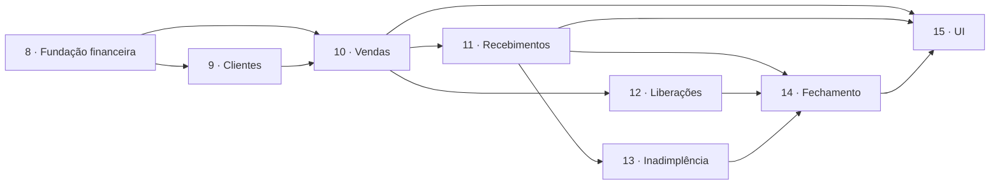

# Plano de implementação — fase 2

> Todas as decisões de design estão fechadas ([31](31-decisoes-pendentes.md)). O plano abaixo
> já reflete as escolhas tomadas.

## Decisões tomadas

Todas as 17 questões de [31](31-decisoes-pendentes.md) foram respondidas em **02/09/2026**.
As que mais mudam o desenho:

- **PD-01: RN-21 mantida absoluta** — não há estoque negativo, não há liberação de estoque,
  não há `allow_negative_stock`. A fase 2 ainda **reforça** a regra com `CHECK (stock >= 0)`;
- **PD-02: cancelamento devolve limite** (pagamento continua não devolvendo);
- **PD-16: recurso `customer-credit`** separado de `customers`;
- **PD-14: fechamento formal fica para a 2.1** — só painel calculado agora;
- **PD-15: estorno é `POST /payments/:id/reversal`**;
- **PD-10 e PD-05** adicionam duas dependências: `date-fns` + `date-fns-tz` (restritas ao
  módulo `finance`) e `@nestjs/schedule` (agendador, não fila).

> **Pendência que não bloqueia o código, mas bloqueia produção:** a redação da anonimização
> de cliente ([PD-17](31-decisoes-pendentes.md#pd-17)) precisa de validação jurídica antes do
> go-live.

## Estado do setup

Concluído antes do épico 8:

- [x] dependências instaladas (`date-fns`, `date-fns-tz`, `@nestjs/schedule`) e registradas
      em [07-stack.md](07-stack.md);
- [x] 16 env vars da fase 2 em `.env.example` + `env.config.ts`, com validação cruzada de
      ordem dos timeouts no boot;
- [x] rebrand para GiroFácil ([ADR-0007](adr/0007-rebrand-girofacil.md));
- [x] RN-21 confirmada em `docs/04-regras-de-negocio.md`;
- [x] layout do comprovante de venda definido ([33](33-comprovante-de-venda.md));
- [x] dataset representativo escrito (`prisma/seeds/phase-two-dataset.ts`), aguardando as
      tabelas dos épicos 9 e 10.

## Épicos

Continuando a numeração de [14](14-gestao-do-trabalho.md) (o MVP foi de 1 a 7):

| # | Épico | Entrega observável |
|---|---|---|
| 8 | Fundação financeira | Configuração da empresa, período, migrações base |
| 9 | Clientes | CRUD, limite, situação financeira, resumo |
| 10 | Vendas | Venda à vista e a prazo, itens, estoque, comprovante |
| 11 | Recebimentos | Pagamento parcial/total, estorno, regularização |
| 12 | Liberações administrativas | Senha, bloqueios, trilha |
| 13 | Inadimplência | Job de atraso, eventos de situação |
| 14 | Fechamento | Painel consolidado, por cliente |
| 15 | UI da fase 2 (FE) | Telas de cliente, venda, recebimento, fechamento |

Cada épico entrega **software funcionando de ponta a ponta**, não uma camada. "Modelagem do
banco" não é épico: cada épico traz suas migrações.

---

### Épico 8 — Fundação financeira

**Por que primeiro:** período e configuração da empresa são pré-requisito de limite,
inadimplência e fechamento. E `period.ts` é a peça com mais casos de borda — melhor
descobrir cedo.

- migração `add_finance_enums`;
- migração `create_company_finance_settings` **com backfill** para todas as empresas
  existentes;
- provisionamento: `CompaniesService` cria as settings ao criar empresa; `seed.ts` e
  `bootstrap-db.ts` acompanham;
- `finance/period.ts` (função pura) + a bateria de testes de calendário de
  [30](30-testes.md);
- rotas `GET`/`PUT /companies/me/finance-settings` + `PUT .../admin-password`;
- permissões `finance-settings:*` no catálogo, no seed e no papel Admin;
- variáveis de ambiente `FINANCE_*` em `.env.example` e `env.config.ts`;
- policy de RLS + `TENANT_SCOPED_MODELS` para o model novo.

**Pronto quando:** uma empresa configura fechamento no dia 15, e `GET` devolve a janela
corrente correta em fevereiro de ano bissexto.

---

### Épico 9 — Clientes

- migração `create_customers` (índice único parcial por documento escrito à mão);
- CRUD + status + `credit-limit` + `credit-block` (permissão `customer-credit:update`);
- limite de clientes do plano (`plans.limits.maxCustomers`, RN-14);
- anonimização a pedido do titular (`anonymized_at`);
- `customer-status.policy.ts` (pura) — ainda sem vendas para classificar, mas já testada;
- `customer_status_events` (migração append-only);
- `financial-summary` devolvendo zeros coerentes (não há venda ainda);
- permissões, papéis, RLS, escopo, teste cross-tenant.

**Pronto quando:** o Admin cadastra cliente, define limite, e a empresa B recebe 404 ao
tentar ler esse cliente.

---

### Épico 10 — Vendas *(o maior; quebrar em histórias)*

Ordem interna sugerida, cada passo entregável:

1. **`sale-totals.ts` + `sale-status.policy.ts`** (puros, testados) — antes de qualquer
   tabela;
1b. migração `alter_items_stock_not_negative` (`CHECK (stock >= 0)`) — a invariante que a
   decisão do PD-01 tornou possível;
2. **extrair para `shared/`** o tratamento de lock/timeout/`55P03`/`P2028` hoje dentro de
   `inventory.service.ts` (refactor sem mudança de comportamento, com os testes existentes
   passando);
3. migrações `create_sales_and_sale_items` (com `CHECK`s e FK composta com tenant);
4. migração `alter_stock_movements_add_sale_origin` (colunas, único parcial, `CHECK`);
5. **venda à vista** completa: `POST /sales`, itens, lock ordenado, baixa, pagamento
   automático, `GET /sales`, `GET /sales/:id`;
6. migração `alter_receipts_add_sale` + comprovante **por venda**, seguindo a especificação
   de [33](33-comprovante-de-venda.md);
7. **venda a prazo**: cliente, vencimento, advisory lock do cliente, consumo de limite,
   validação de crédito coletando **todos** os bloqueios (ainda sem liberação: bloqueio é
   422 definitivo);
8. **cancelamento**: `PATCH /sales/:id/status`, movimentação inversa, recálculo do cliente,
   bloqueio quando há pagamento;
9. testes de concorrência (estoque e limite) e o teste de deadlock com ordem inversa de
   itens.

**Pronto quando:** duas vendas simultâneas de 8 sobre estoque 10 resultam em uma venda e um
422, com estoque final 2 — e duas vendas de 600 sobre limite 1.000 resultam em uma venda e
um bloqueio.

---

### Épico 11 — Recebimentos

- migração `create_payments` (`CHECK` de estorno, `CHECK` de `paid_amount ≤ total` em
  `sales`);
- `POST /payments` com lock da venda, atualização de `paid_amount` e status;
- recálculo da situação do cliente + `customer_status_events`;
- estorno via `POST /payments/:id/reversal`;
- `GET /payments` com filtros.

**Pronto quando:** dois recebimentos parciais quitam a venda, o cliente é regularizado, e o
limite utilizado **não** muda.

---

### Épico 12 — Liberações administrativas

- migração `create_sale_authorizations` (append-only);
- verificação da senha **fora** da transação; rate limit + lockout progressivo reusando
  `modules/auth/lockout`;
- revalidação sob lock; `authorizable` calculado no servidor;
- `blocks[]` no corpo do erro (ajuste no `AllExceptionsFilter` para preservar campos extras);
- `GET /sale-authorizations`;
- teste explícito de que a senha não aparece em log, resposta nem `audit_logs`.

**Pronto quando:** uma venda bloqueada por limite **e** inadimplência é liberada em uma
requisição, gerando duas linhas de autorização — e uma venda com estoque insuficiente **não**
é liberada, nem com a senha correta.

---

### Épico 13 — Inadimplência

- `@nestjs/schedule` + job diário com advisory lock;
- materialização de `OVERDUE` e da situação do cliente;
- filtros `overdue=true` nas listagens;
- teste que prova que a decisão de crédito está correta **com o job desligado**.

**Pronto quando:** com o job parado por três dias, a venda a prazo para cliente com título
vencido continua sendo bloqueada.

---

### Épico 14 — Fechamento

- `GET /closings/summary`, `/by-customer`, `/periods`;
- agregações com filtro, poucas queries;
- separação competência × caixa com desdobramento por origem;
- `DISTINCT sale_id` nos totais de liberação (com teste dedicado);
- `period_closures` **não** entra nesta fase ([PD-14](31-decisoes-pendentes.md#pd-14)).

**Pronto quando:** uma venda de setembro paga em outubro aparece corretamente nos dois
painéis, e o total liberado de uma venda com duas autorizações conta uma vez.

---

### Épico 15 — UI (repositório `ProMei-FE`)

Fora do escopo desta documentação de back-end, mas o contrato está pronto em
[28](28-api-contracts.md). Pontos de atenção para o front:

- `blocks[]` com `authorizable` já resolvido — o front **não** recalcula regra;
- `period` × `lifetime` no resumo do cliente são escalas diferentes e precisam de rótulo;
- botão de venda desabilitado após o clique (mitigação de duplicata até PD-12);
- `Decimal` chega como **string** no JSON: nunca `parseFloat` para exibir ou somar.

## Sequência e dependências

O caminho crítico é **8 → 9 → 10 → 11**. Liberações (12) pode correr em paralelo com
recebimentos (11) depois que vendas estiver de pé.

## Riscos

| Risco | Sinal precoce | Mitigação |
|---|---|---|
| Cálculo de período errado em borda de mês | Testes de calendário falhando no épico 8 | Fazer `period.ts` **primeiro**, antes de qualquer tabela |
| Deadlock com múltiplos itens | Teste de ordem inversa | `ORDER BY id` no `FOR UPDATE`, ordem de lock documentada |
| Comprovante por item em vez de por venda | Uma venda gerando N comprovantes no primeiro teste | Épico 10 passo 6, antes de venda a prazo |
| Regra financeira espalhada em controller | Revisão de PR | Funções puras primeiro; PR que põe regra em controller volta |
| Vazamento cross-tenant em model novo | Teste de cobertura de escopo | Teste que enumera models com `company_id` e falha se faltar |
| Senha administrativa em log | Grep no PR | Lista de redação + item no checklist de PR |
| Migração pesada em produção | Tempo de `migrate deploy` em staging | Migrações aditivas, sem `NOT NULL` sem default, sem reescrita de tabela |
| Escopo crescendo (parcelamento, devolução parcial) | Discussão em PR | PD-09 e [26](26-cancelamentos-e-estornos.md) já dizem que ficam fora |

## Definition of Done da fase 2

Além do DoD do [14](14-gestao-do-trabalho.md):

- [ ] `CHECK (stock >= 0)` aplicado e coberto por teste;
- [ ] anonimização de cliente validada juridicamente antes do go-live;
- [ ] `docs/07-stack.md` com `date-fns` e `@nestjs/schedule` registrados;
- [ ] todos os models novos em `TENANT_SCOPED_MODELS` **e** com policy de RLS;
- [ ] teste de isolamento cross-tenant cobrindo todas as rotas novas;
- [ ] testes de concorrência (estoque e limite) verdes;
- [ ] bateria de calendário completa (dias 1, 28, 29, 30, 31, fevereiro, bissexto);
- [ ] nenhuma constante de configuração hardcoded (docs/16);
- [ ] senha administrativa ausente de logs, respostas e trilha, comprovado por teste;
- [ ] `docs/README.md` com os documentos 17–32 no índice;
- [ ] validado em staging com dados de seed representativos.
