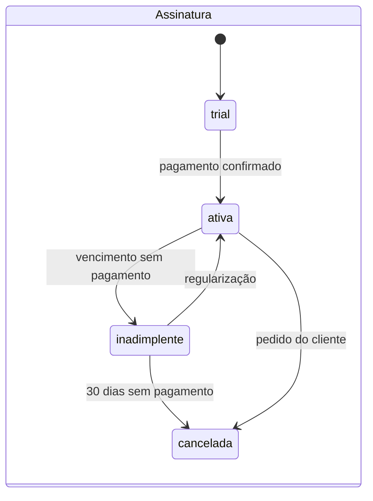
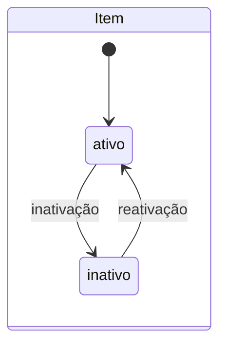

# Regras de Negócio — ProMei FE

## Papéis e permissões

| Regra | Descrição |
|---|---|
| RN-01 | Super Admin pode tudo na plataforma; Staff pode gerenciar empresas e assinaturas, mas não outros usuários da plataforma. |
| RN-02 | Admin da empresa gerencia usuários, papéis, itens e estoque **somente da própria empresa**. |
| RN-03 | Colaborador só faz o que o papel atribuído permite; por padrão: consultar itens e registrar saídas. |
| RN-04 | Uma empresa precisa ter ao menos 1 Admin ativo; o último Admin não pode ser removido ou rebaixado. |
| RN-05 | Usuário pertence a exatamente 1 empresa (exceto Staff/Super Admin, que não pertencem a nenhuma). |

## Empresas e assinaturas

| Regra | Descrição |
|---|---|
| RN-10 | Empresa só é criada por Super Admin/Staff (não existe register no MVP). |
| RN-11 | Estados da empresa: `ativa` → `suspensa` → `ativa`; `ativa` → `cancelada` (terminal, dados retidos por 90 dias e depois anonimizados/excluídos). |
| RN-12 | Estados da assinatura: `trial` → `ativa` → `inadimplente` → (`ativa` ao regularizar \| `cancelada` após 30 dias). |
| RN-13 | Empresa `inadimplente`: acesso em **modo leitura** (consulta, sem criar/editar). Empresa `suspensa` ou `cancelada`: bloqueio total de login. |
| RN-14 | Limites do plano (usuários, itens) são validados na criação; exceder o limite bloqueia novos cadastros, não apaga existentes. |
| RN-15 | Mudança de plano tem efeito imediato; cobrança proporcional é tratada manualmente no MVP. |

## Itens e estoque

| Regra | Descrição |
|---|---|
| RN-20 | SKU/código é único por empresa (não globalmente). |
| RN-21 | Estoque nunca fica negativo: saída maior que o saldo é rejeitada. |
| RN-22 | Toda movimentação é imutável: correções geram movimentação de **ajuste**, nunca edição/exclusão do histórico. |
| RN-23 | Item com movimentações não pode ser excluído — apenas **inativado**. |
| RN-24 | Comprovante de saída recebe numeração sequencial por empresa e não tem valor fiscal (texto obrigatório no rodapé: "Documento sem valor fiscal"). |
| RN-25 | Campos obrigatórios do item: nome, unidade, preço. SKU é gerado automaticamente se não informado. |

## Estados das entidades

## Tabela de decisão — acesso ao painel

| Empresa | Assinatura | Login | Escrita | Leitura |
|---|---|---|---|---|
| ativa | trial/ativa | ✅ | ✅ | ✅ |
| ativa | inadimplente | ✅ | ❌ | ✅ |
| suspensa | qualquer | ❌ | ❌ | ❌ |
| cancelada | qualquer | ❌ | ❌ | ❌ |

## Exemplos de entrada e saída

**Saída de estoque válida**
- Entrada: item `PARAF-001` (saldo 50), saída de 10 un, motivo "venda balcão".
- Saída: saldo 40, movimentação registrada, comprovante nº 000123 gerado.

**Saída inválida**
- Entrada: item `PARAF-001` (saldo 40), saída de 100 un.
- Saída: erro `ESTOQUE_INSUFICIENTE`, nada é gravado.
