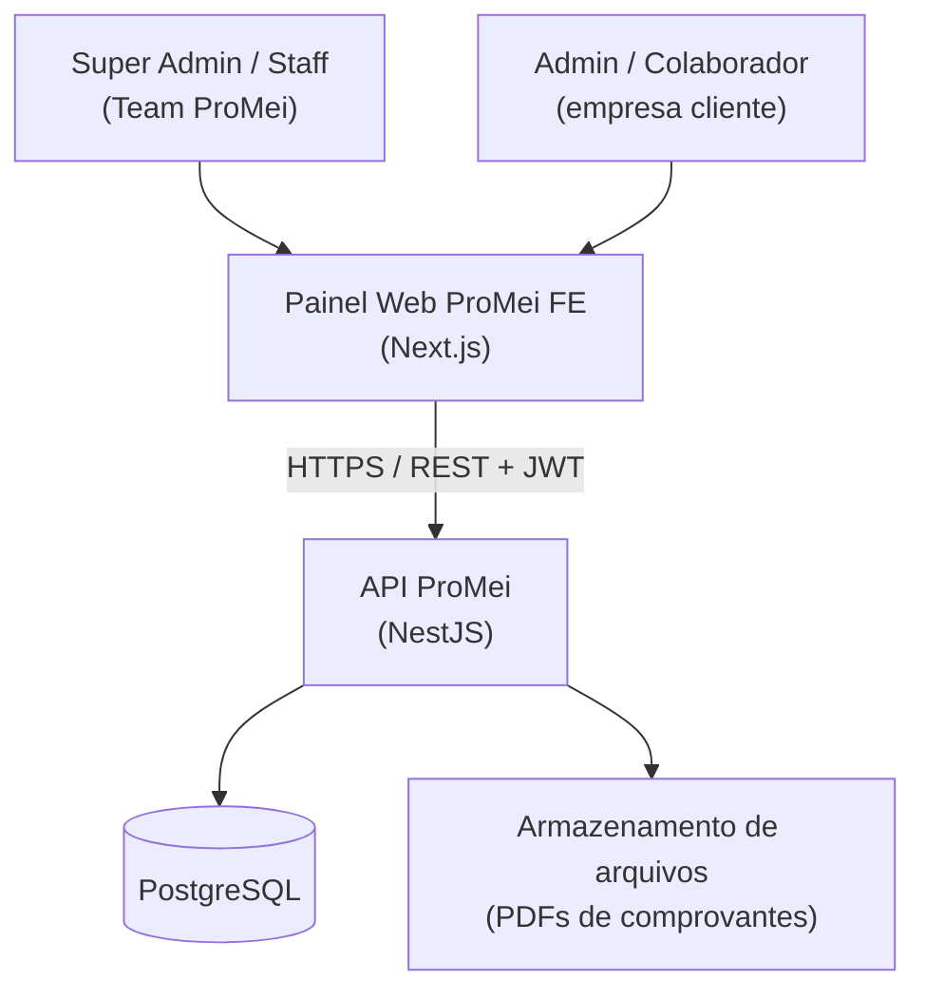

# Arquitetura — ProMei FE

Decisões formais em `docs/adr/`. Este documento dá a visão geral.

## Diagrama de contexto (C4 nível 1)



Integrações externas no MVP: **nenhuma**. Futuras: gateway de pagamento, provedor de e-mail, API de NFS-e.

## Containers (C4 nível 2)

| Container | Tecnologia | Responsabilidade |
|---|---|---|
| Painel Web | Next.js + Tailwind | UI responsiva, dark/light, consumo da API |
| API | NestJS (Node 22 LTS) | Regras de negócio, auth, permissionamento, multi-tenant |
| Banco | PostgreSQL 16 | Dados de todos os tenants (schema compartilhado) |
| Storage | S3-compatível (ou disco no MVP) | PDFs de comprovantes |

## Componentes da API (módulos NestJS)

- `auth` — login, JWT, refresh, guards;
- `permissions` — papéis, permissões, CASL/guard por recurso;
- `companies` — tenants, planos, assinaturas;
- `users` — usuários por empresa;
- `items` — CRUD de itens;
- `inventory` — movimentações de estoque, comprovantes;
- `audit` — trilha de auditoria;
- `shared` — filtro de tenant, interceptors, logging.

## Multi-tenancy

**Banco único, schema compartilhado, coluna `company_id`** em toda tabela de negócio (ver [ADR-0003](adr/0003-multi-tenancy-postgres.md)).

- O JWT carrega `company_id` (null para Super Admin/Staff);
- Uma **Client Extension** do Prisma injeta o tenant em todas as queries (escopo global).
  O antigo `$use` (client middleware) foi **removido no Prisma 7** — a substituição oficial é
  `$extends({ query: { $allModels: ... } })`, aplicada uma única vez no `PrismaService`;
- Defesa em profundidade: Postgres Row-Level Security como segunda barreira.

## Modelo inicial do banco (ERD)

```mermaid
erDiagram
    COMPANY ||--o{ USER : possui
    COMPANY ||--o{ ITEM : possui
    COMPANY ||--|| SUBSCRIPTION : possui
    PLAN ||--o{ SUBSCRIPTION : define
    USER }o--o{ ROLE : possui
    ROLE }o--o{ PERMISSION : concede
    ITEM ||--o{ STOCK_MOVEMENT : movimenta
    USER ||--o{ STOCK_MOVEMENT : registra
    STOCK_MOVEMENT }o--|| RECEIPT : "saídas geram"

    COMPANY { uuid id PK; text name; text document; text status }
    USER { uuid id PK; uuid company_id FK; text email; text password_hash; text status }
    ROLE { uuid id PK; uuid company_id FK; text name; bool is_system }
    PERMISSION { uuid id PK; text resource; text action }
    PLAN { uuid id PK; text name; numeric price; text period; jsonb limits }
    SUBSCRIPTION { uuid id PK; uuid company_id FK; uuid plan_id FK; text status; date renews_at }
    ITEM { uuid id PK; uuid company_id FK; text sku; text name; text description; text unit; text category; numeric price; int stock; int min_stock; text status }
    STOCK_MOVEMENT { uuid id PK; uuid company_id FK; uuid item_id FK; uuid user_id FK; text type; int quantity; text reason; timestamptz created_at }
    RECEIPT { uuid id PK; uuid company_id FK; bigint number; text pdf_url; timestamptz created_at }
```

## Fluxo crítico — saída de estoque (sequência)

```mermaid
sequenceDiagram
    participant U as Colaborador
    participant W as Web
    participant A as API
    participant D as Postgres

    U->>W: registra saída (item, qtd, motivo)
    W->>A: POST /stock-movements (JWT)
    A->>A: valida permissão + tenant
    A->>D: BEGIN; SELECT stock FOR UPDATE
    alt saldo suficiente
        A->>D: INSERT movement; UPDATE item.stock; INSERT receipt; COMMIT
        A->>A: gera PDF do comprovante
        A-->>W: 201 + link do comprovante
    else saldo insuficiente
        A->>D: ROLLBACK
        A-->>W: 422 ESTOQUE_INSUFICIENTE
    end
```

## Autenticação e autorização

- JWT access (15 min) + refresh (7 dias, rotacionado, armazenado com hash);
- Payload: `sub`, `company_id`, `roles`;
- Autorização: guard por permissão (`recurso:ação`) + escopo de tenant sempre aplicado.

## Deploy e falhas

- API e Web em containers Docker; deploy via CI (ver [11-infra-ci-cd.md](11-infra-ci-cd.md));
- API stateless → réplicas horizontais quando necessário;
- Falha de geração de PDF não bloqueia a movimentação: comprovante é gerado assíncrono com retry; se falhar, fica pendente e regenerável.
  - Sem fila no MVP (ver [07-stack.md](07-stack.md)): o retry é em processo, com backoff exponencial (`RECEIPT_PDF_MAX_ATTEMPTS`, `RECEIPT_PDF_RETRY_DELAY_MS`). Comprovante pendente é o que está sem `pdf_url`; o PDF é regerado sob demanda no download ou por `POST /receipts/:id/regenerate`. O número sequencial, esse, é emitido dentro da transação da saída — ele não pode faltar nem repetir (RN-24).

## Observabilidade

Resumo em [13-observabilidade.md](13-observabilidade.md): logs JSON com `correlation_id` e `company_id`, métricas HTTP, Sentry para erros, health checks `/health`.
