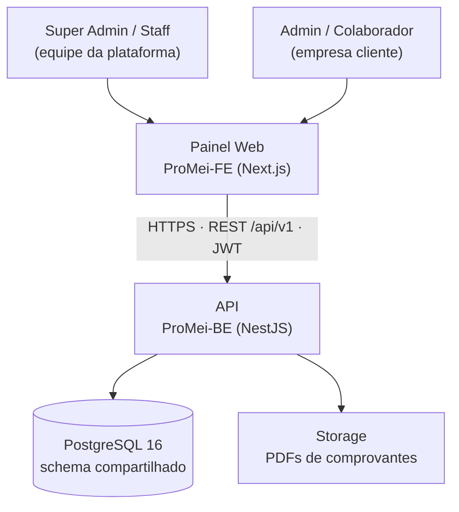
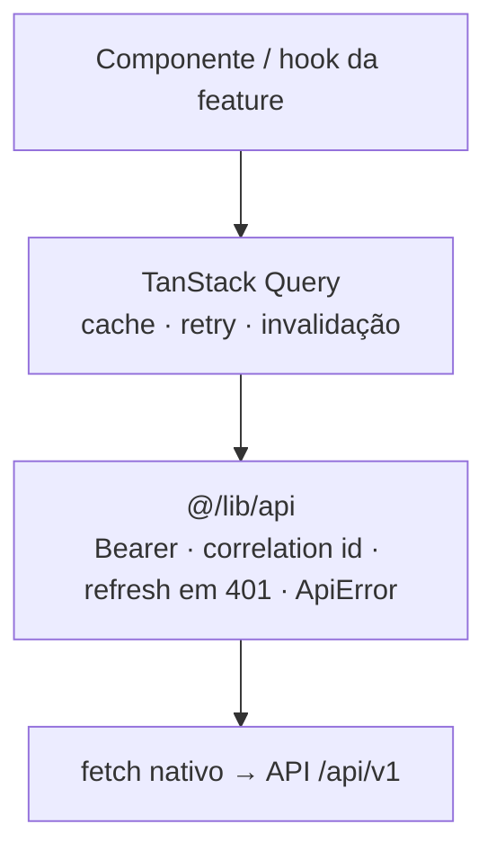

<div align="center">


# ProMei

**SaaS multi-tenant de gestão comercial para MEIs**

Estoque · itens · vendas · comprovantes · papéis e permissões · planos e assinaturas

<br />


<br />


[**Back-end**](ProMei-BE/README.md) · [**Front-end**](ProMei-FE/README.md) · [**Docs BE**](ProMei-BE/docs/README.md) · [**Docs FE**](ProMei-FE/docs/README.md) · [**ADRs**](ProMei-BE/docs/adr/)

</div>

---

## 📦 Projetos

| Pasta                      | Aplicação     | Stack principal                                                              |
| -------------------------- | ------------- | ---------------------------------------------------------------------------- |
| [`ProMei-BE/`](ProMei-BE/) | 🔌 API REST   | NestJS 11 (adapter Fastify) · TypeScript · Prisma 7 · PostgreSQL 16          |
| [`ProMei-FE/`](ProMei-FE/) | 💻 Painel web | Next.js 15 (App Router) · React 19 · Tailwind 4 · shadcn/ui · TanStack Query |

> [!NOTE]
> Este README dá a **visão de arquitetura e as boas práticas** compartilhadas pelos dois lados.
> Instruções de execução, scripts e detalhes de cada aplicação ficam nos READMEs internos:
> [ProMei-BE/README.md](ProMei-BE/README.md) (API, Prisma, observabilidade, pipeline) e
> [ProMei-FE/README.md](ProMei-FE/README.md) (painel e convenções de UI).

## 📑 Sumário

- [Visão geral da arquitetura](#-visão-geral-da-arquitetura)
- [Back-end — `ProMei-BE`](#-back-end--promei-be)
- [Front-end — `ProMei-FE`](#-front-end--promei-fe)
- [Contrato entre FE e BE](#-contrato-entre-fe-e-be)
- [Práticas comuns aos dois projetos](#-práticas-comuns-aos-dois-projetos)
- [Documentação detalhada](#-documentação-detalhada)

---

## 🧭 Visão geral da arquitetura



- **Monolito modular** no back-end: um processo, um banco, módulos de domínio bem separados.
  Sem filas nem microsserviços enquanto não houver necessidade real.
- **API stateless**, empacotada em Docker — escala horizontalmente com réplicas.
- **O front-end é cliente da API**, nunca autoridade: validação e permissão no painel servem à
  UX; quem decide é a API.

Decisões formais estão registradas como ADRs em [`ProMei-BE/docs/adr/`](ProMei-BE/docs/adr/).

---

## 🔌 Back-end — `ProMei-BE`

### Organização por módulo de domínio

```
src/
├── modules/          # um módulo NestJS por domínio de negócio
│   ├── auth/  users/  roles/  permissions/
│   ├── companies/  plans/  subscriptions/
│   ├── items/  inventory/  receipts/
│   ├── customers/  sales/  payments/  finance/
│   └── audit/  health/  observability/
│       └── <módulo>.controller.ts · <módulo>.service.ts · dto/ · <módulo>.module.ts
└── shared/           # infraestrutura transversal, sem regra de negócio de domínio
    ├── access/       # política de acesso (função pura) + guard de assinatura
    ├── tenant/       # contexto de tenant (AsyncLocalStorage) + Client Extension do Prisma
    ├── guards/       # JWT, permissão, troca de senha obrigatória, rate limit
    ├── filters/      # filtro global de exceções → envelope de erro padrão
    ├── errors/       # exceptions de negócio tipadas
    ├── config/       # env validada com zod no boot
    ├── logging/  interceptors/  sentry/  # observabilidade
    ├── prisma/  pagination/  concurrency/  decorators/  http/
```

**Boas práticas adotadas:**

- ✅ **Controller fino, service com a regra.** Regras de decisão críticas ficam em **funções puras**
  (`access-policy.ts`, `lockout.policy.ts`, `sale-status.policy.ts`, `stock-delta.ts`…), testáveis
  sem banco nem HTTP.
- ✅ **DTOs validados em todo endpoint** — a API nunca confia no que vem do cliente.
- ✅ **Configuração sem hardcode:** todo valor ajustável vem de variável de ambiente validada por
  zod no boot. Com config inválida, a aplicação não sobe.

### 🏢 Multi-tenancy em camadas

> [!IMPORTANT]
> Isolamento entre empresas é o **risco nº 1 do produto**. Banco único, schema compartilhado,
> coluna `company_id` em toda tabela de negócio
> ([ADR-0003](ProMei-BE/docs/adr/0003-multi-tenancy-postgres.md)), protegido por **defesa em
> profundidade**.

| Barreira                                | Protege contra                                                 |
| --------------------------------------- | -------------------------------------------------------------- |
| **Client Extension do Prisma**          | Query da aplicação sem filtro — injeta `company_id` como `AND` |
| **Guard de rota** (`PermissionsGuard`)  | Usuário de plataforma acessando rota de tenant (responde 404)  |
| **Row-Level Security** + papel restrito | Acesso direto ao banco (psql, BI, scripts de suporte)          |

- Os models escopados ficam numa **lista explícita** — tabela nova não entra nem sai do escopo
  por acidente.
- Pedir dados de outra empresa resulta em **vazio**, não em dados da própria empresa, para não
  mascarar bug.
- Um **teste de isolamento cross-tenant** roda em todo PR e é inegociável.

### 🔐 Autenticação e autorização

- **JWT de acesso curto (15 min) + refresh token rotacionado** (7 dias), armazenado com hash.
- **Autorização sempre por permissão (`recurso:ação`), nunca por nome de papel**, porque os
  clientes criam papéis customizados.
- **Fechado por padrão:** o guard é global e toda rota declara o que exige. Esquecer o decorator
  fecha a rota em vez de abri-la.

  ```ts
  @RequirePermission('items:create')   // exige a permissão recurso:ação
  @PlatformRoute()                     // só Super Admin/Staff
  @AnyAuthenticated()                  // qualquer autenticado
  @Public()                            // sem autenticação
  ```

- **Permissões no token servem só à UI; o banco é a autoridade**
  ([ADR-0005](ProMei-BE/docs/adr/0005-permissions-jwt-with-db-validation.md)). Revogar uma
  permissão tem efeito quase imediato, sem esperar o token expirar.
- **Tabela de decisão de acesso** (empresa × assinatura → login/leitura/escrita) implementada como
  função pura e aplicada no login e num guard de escrita.
- Bloqueio de conta por tentativas, troca de senha obrigatória e rate limiting.

### 🔄 Consistência transacional

- Operações que mexem em estoque e dinheiro são **agregados transacionais únicos**
  ([ADR-0006](ProMei-BE/docs/adr/0006-vendas-como-agregado-transacional.md)): ou tudo é gravado,
  ou nada. Estados proibidos (venda sem baixa de estoque, baixa sem venda) ficam impossíveis
  por construção, sem compensações escritas à mão.
- **Locks pessimistas** (`SELECT … FOR UPDATE`) com **ordem fixa** e `lock_timeout`
  configurável, para garantir estoque nunca negativo sob concorrência sem gerar deadlock.
- Números sequenciais (comprovantes, vendas) emitidos **dentro da transação** — não faltam nem
  repetem.
- Trabalho lento e falível (geração de PDF) fica **fora** do caminho crítico, com retry e
  regeneração sob demanda.

### 📊 Auditoria e observabilidade

- **Trilha de auditoria append-only garantida pelo banco** (trigger que rejeita `UPDATE`), com
  `diff` antes/depois. É gravada **fora** da transação de negócio, para sobreviver ao rollback
  da falha que ela registra.
- **Correlation id único ponta a ponta:** nasce em um só lugar e é o mesmo no log, no header de
  resposta, no corpo do erro e no Sentry.
- **Logs JSON estruturados** (Pino) com `company_id`/`user_id` e redação de campos sensíveis.
- **Envelope de erro padrão** `{ statusCode, code, message, correlationId }`. Erros 5xx nunca
  vazam stack trace, SQL ou caminhos; 4xx de negócio não poluem o Sentry.
- **Health checks separados:** liveness (`/health`) e readiness (`/health/ready`, banco +
  migrações). A API sobe degradada em vez de morrer quando o banco cai.

---

## 💻 Front-end — `ProMei-FE`

### Organização por feature

```
src/
├── app/                  # rotas do App Router — páginas FINAS (metadata + composição)
│   ├── (auth)/           # login, troca de senha
│   └── (dashboard)/      # rotas autenticadas (AuthGuard no layout do grupo)
├── features/<domínio>/   # tudo de um domínio junto:
│   ├── api.ts            #   chamadas HTTP
│   ├── hooks.ts          #   TanStack Query (queries e mutations)
│   ├── schemas.ts        #   validação zod dos formulários
│   ├── types.ts          #   contratos do domínio
│   ├── *.ts              #   lógica pura testável (regras, formatação, cálculo)
│   └── components/       #   componentes da feature
├── components/           # compartilhados: ui/ (shadcn), layout/, estados de erro/vazio/loading
├── lib/                  # api/ (client HTTP, ApiError, sessão), env.ts, query-client.ts
├── hooks/                # hooks genéricos, sem domínio
├── styles/               # tokens do tema (CSS variables)
└── types/                # contratos HTTP comuns (ex.: paginação)
test/                     # testes Vitest espelhando a árvore de src/
```

**Boas práticas adotadas:**

- ✅ **Página não tem lógica:** `app/` só compõe componentes de `features/`.
- ✅ **Lógica de domínio em módulos puros** dentro da feature, separada dos componentes e testável
  isoladamente.
- ✅ **Componentes padronizados para estados de tela:** `ApiErrorAlert`, `ListEmptyState`,
  `TableSkeletonRows`.

### 🔗 Camada de dados única



- **Nenhum `fetch` direto** em componente ou hook: toda chamada passa pelo client.
- **Refresh single-flight:** várias requisições que tomam 401 ao mesmo tempo disparam **um**
  refresh, o que evita derrubar a sessão por causa da rotação do refresh token.
- **Access token só em memória**; sessão expirada limpa o cache e redireciona ao login em um
  único ponto.
- **Erro único (`ApiError`) sempre com `code`:** a UI decide pelo código de negócio, nunca pelo
  `statusCode`, e exibe o correlation id para suporte.
- **Retry consciente:** queries não repetem em 4xx de negócio; **mutations nunca repetem**, porque
  repetir poderia duplicar uma saída de estoque.
- **Cancelamento:** o `signal` do TanStack Query é repassado a toda chamada.
- **`QueryClient` por request no servidor**, para que o cache nunca vaze dados entre tenants.

### 🎨 Design system e configuração

- **Sem hardcode visual:** cores, espaçamentos e raios vêm de **tokens semânticos** (CSS
  variables + Tailwind), nunca de hex avulso
  ([DESIGN-SYSTEM.md](ProMei-FE/docs/styles/DESIGN-SYSTEM.md)).
- **Temas por nicho** da empresa e **dark/light** com `next-themes`.
- **Configuração de ambiente validada com zod** em `lib/env.ts`.

---

## 🤝 Contrato entre FE e BE

| Aspecto           | Padrão                                                                                    |
| ----------------- | ----------------------------------------------------------------------------------------- |
| Versionamento     | Prefixo `/api/v1`; REST com recursos no plural em kebab-case (`/stock-movements`)         |
| Erros             | Envelope `{ statusCode, code, message, correlationId }` com códigos de negócio espelhados no front (`business-error-code.ts`) |
| Paginação         | `?page=&limit=` (limite máximo 100)                                                       |
| Rastreabilidade   | Correlation id gerado no front e reaproveitado pela API — um print do usuário vira uma única busca nos logs |
| Fonte de verdade  | A API ([ADR-0004](ProMei-BE/docs/adr/0004-multi-repo.md)); mudanças que atravessam as duas camadas são coordenadas |

---

## 🧰 Práticas comuns aos dois projetos

| Tema         | Prática                                                                                       |
| ------------ | --------------------------------------------------------------------------------------------- |
| Linguagem    | TypeScript com `strict: true`                                                                 |
| Qualidade    | ESLint (flat config) + Prettier, obrigatórios no CI                                           |
| Pacotes      | **pnpm** com lockfile versionado; dependências críticas com versão exata                      |
| Nomenclatura | Arquivos `kebab-case`, classes `PascalCase`, funções `camelCase`; tabelas `snake_case` plural |
| Idioma       | Código e identificadores em **inglês**; UI e documentação em **pt-BR**                        |
| Configuração | Env validada com zod; `.env.example` versionado, `.env` nunca commitado                       |
| Git          | `feat/*` → `development` → `staging` → `main`, só via PR, squash merge, Conventional Commits  |
| CI           | Jobs `lint` (format + lint + typecheck), `test`, `audit` (crítica bloqueia) e `build`         |
| Gate local   | Hook `pre-push` que bloqueia push direto nas branches protegidas e roda os gates do CI        |
| Documentação | `docs/` numerada (produto, requisitos, regras, arquitetura, segurança…) + ADRs                |

### 🧪 Estratégia de testes

| Nível      | Back-end                                                                                                       | Front-end                                      |
| ---------- | -------------------------------------------------------------------------------------------------------------- | ---------------------------------------------- |
| Unitário   | Vitest em services, policies e guards                                                                          | Vitest em lógica pura e no client HTTP         |
| Integração | Supertest + **Postgres real via Testcontainers**                                                               | —                                              |
| Críticos   | Isolamento cross-tenant, RLS, concorrência de estoque/vendas, lock timeout, falha parcial, trilha de auditoria | Refresh de sessão sob concorrência, permissões |
| Pós-deploy | Smoke test de fluxo (login → item → entrada → saída → PDF → auditoria)                                         | —                                              |

### 🚀 Infraestrutura (BE)

- **Dockerfile + docker-compose** para desenvolvimento e deploy.
- **Workflows separados** para CI, deploy de staging, deploy de produção e rollback.
- **Backup do Postgres automatizado**, com **teste de restauração** agendado.
- **Migrações apenas via Prisma Migrate**; migração aplicada nunca é editada, e migração
  destrutiva exige plano de rollback no PR.
- Proteção de branch versionada como código (`.github/rulesets/*.json`).

---

## 📚 Documentação detalhada

| Assunto                    | Back-end                                                                           | Front-end                                                                          |
| -------------------------- | ---------------------------------------------------------------------------------- | ---------------------------------------------------------------------------------- |
| Índice                     | [docs/README.md](ProMei-BE/docs/README.md)                                         | [docs/README.md](ProMei-FE/docs/README.md)                                         |
| Arquitetura                | [06-arquitetura.md](ProMei-BE/docs/06-arquitetura.md)                              | [06-arquitetura.md](ProMei-FE/docs/06-arquitetura.md)                              |
| Padrões de desenvolvimento | [08-padroes-de-desenvolvimento.md](ProMei-BE/docs/08-padroes-de-desenvolvimento.md) | [08-padroes-de-desenvolvimento.md](ProMei-FE/docs/08-padroes-de-desenvolvimento.md) |
| Segurança                  | [09-seguranca.md](ProMei-BE/docs/09-seguranca.md)                                  | [09-seguranca.md](ProMei-FE/docs/09-seguranca.md)                                  |
| Testes                     | [12-estrategia-de-testes.md](ProMei-BE/docs/12-estrategia-de-testes.md)            | [12-estrategia-de-testes.md](ProMei-FE/docs/12-estrategia-de-testes.md)            |
| Configuração sem hardcode  | [16-configuracao-sem-hardcode.md](ProMei-BE/docs/16-configuracao-sem-hardcode.md)  | [16-configuracao-sem-hardcode.md](ProMei-FE/docs/16-configuracao-sem-hardcode.md)  |
| Camada de dados            | —                                                                                  | [17-camada-de-dados.md](ProMei-FE/docs/17-camada-de-dados.md)                      |
| Decisões (ADRs)            | [docs/adr/](ProMei-BE/docs/adr/)                                                   | [docs/adr/](ProMei-FE/docs/adr/)                                                   |
